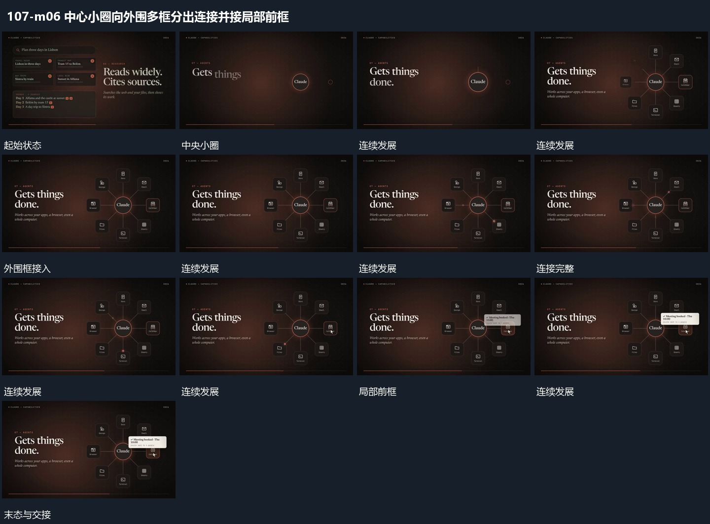

# 中心小圈向外围多框分出连接并接局部前框

## 运动指令

从中央小圈向外围不同方向延长连接，连接末端的小框依次接入。外围组齐全后选一处补出小前框，前框从该处展开并覆盖部分连接；中心圈与其余框保持，不同时消失。

## 视频切片

[播放本机制的原片切片](m06.mp4)

覆盖分镜中“中央小圈”至“前框保持”的连续过程，并保留邻近的前后衔接画面；原片中交叠发生的动作一并保留。

## 分镜过程

## 组合与调整

可减少外围项；前框来自明确末端，组合时保留中央圈作为持续参照。
