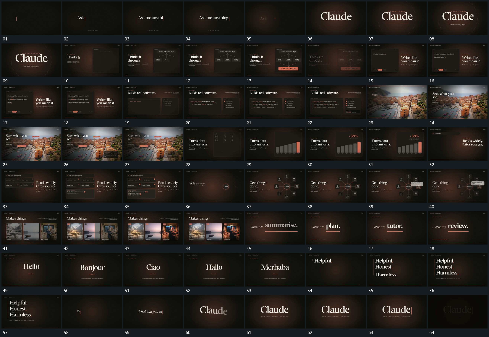

# 107｜原片运动总览

[观看完整原片](video.mp4)

## 运动总览

全片多次复用逐字填入完成后局部替换再补下线的逐字填入、局部替换和下线建立。首个框内上方节点分出连接末端框接入再汇到下框从上方节点分出多条连接，末端框和下方结果框依次接入。后续双框使用双框保持一侧逐行填入另一侧逐项补标记，一侧逐行填入，另一侧逐项补标记。

图片段由大图片保持局部短线与标签分次派生从局部派生短标线与标签，底图保持。数据段框内旧行列退去竖条从共同底部增长让旧行列退去，竖条从共同底部逐次增长。随后中心小圈向外围多框分出连接并接局部前框将中心小圈扩展为外围多个框，并在其中一处接入小前框。结尾继续复用逐字填入完成后局部替换再补下线，同一前段保持而后段短行接替，最后多行按先后建立并退弱。

## 完整运动段落

以下按原片中的出现顺序引用。建立、内部发展及完成反馈放在同一段中；同时发生的局部动作与运镜写在同一份指令里。不同段之间可以是连续接管，也可以是直接切换，不能仅凭条目相邻认定可直接拼接。重复出现的同类运动采用一次连续代表范围，切片不以逐段无缝覆盖整片为目标。

1. [逐字补成整行并退去，新主行建立后补下线](mechanisms/m01.md)：从起点短标开始逐字补入，短标跟着末端前移。完整行短暂保持后逐渐退去，新主行在中央建立；下方细线从短到长展开，附属小行随后补齐，主行保持。

2. [上方节点分出连接末端框接入再汇到下框](mechanisms/m02.md)：分支建立后向下接续

3. [双框保持一侧逐行填入另一侧逐项补标记](mechanisms/m03.md)：主侧填入旁侧接续

4. [大图片保持局部短线与标签分次派生](mechanisms/m04.md)：局部指向后标签累积

5. [框内旧行列退去竖条从共同底部增长](mechanisms/m05.md)：旧层释放后竖条累积

6. [中心小圈向外围多框分出连接并接局部前框](mechanisms/m06.md)：分支向外建立局部再接入

切片保留起始准备、必要内部停顿和完成或明确交接；首尾省略无新发展的等待，持续运动不要求人为停住。以上基于真实源帧序列和重点边界核对，不等同于全片连续声画审片。

## 完整64宫格

