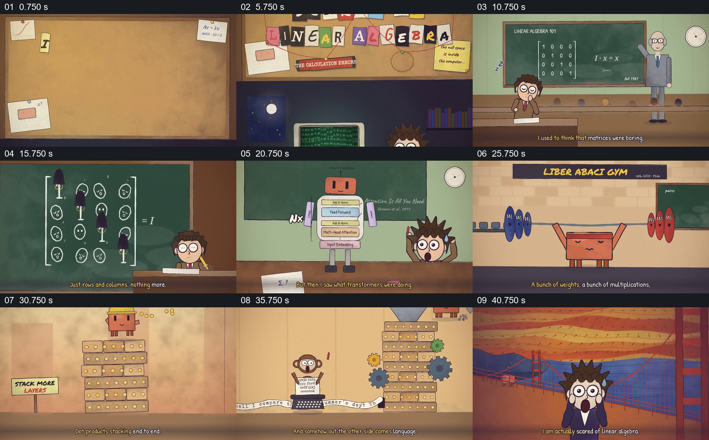

# 从害怕公式的课堂回忆走到矩阵角色的意外能力

- 作品：案例 068《线性代数与机器行为的动画叙述》（本次概括）。
- 原片范围：00:00.000–00:45.000，含起点、不含终点；[完整原片](../video.mp4)｜[本卡片段](c01.mp4)。
- 观察方式：依据整片 64 宫格和约每秒一次的真实源帧观察，未连续原速观看或听审；声音、语气与完整播放节奏未确认。

## 原画面具体怎样设计

拼贴文字写出害怕线性代数，人物坐在电脑旁并回到课堂；黑板上的单位矩阵变成一排角色。橙色矩阵角色在健身房举起杠铃，随后多层方块堆叠，打字机旁输出长纸带；人物面对纸带，表情由平静转为惊讶。

## 为什么这样设计，好在哪里

先给角色一个朴素的课堂形象，再让同一角色进入不寻常的工作与输出，观众能把惊讶追溯到前面建立的对象。具体模型过程和文字来源是作品化示意。

以上为依据画面的分析，非作者自述；预期观看效果未经观众测试。

## 可直接使用的创意指令

当用拟人角色讲述对抽象工具的态度变化时，先在熟悉环境建立工具的原始形态，再让同一角色经过可观察的操作产生具体结果，用人物反应收束；数学与技术关系须依据可靠资料，不把夸张行为当实际能力。
