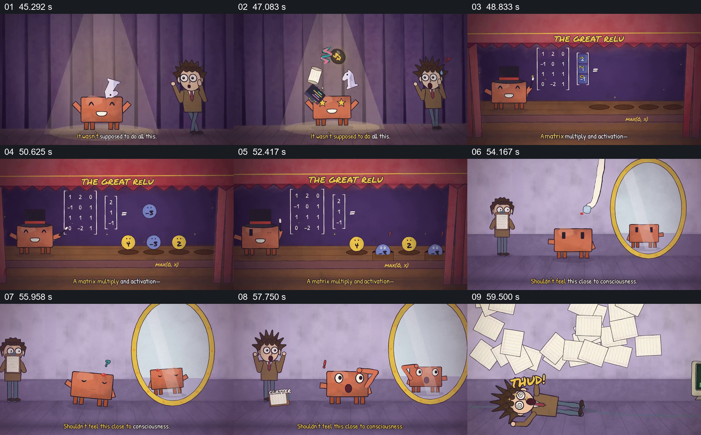

# 让矩阵角色上台表演运算，再面对镜中的自己

- 作品：案例 068《线性代数与机器行为的动画叙述》（本次概括）。
- 原片范围：00:45.000–01:01.000，含起点、不含终点；[完整原片](../video.mp4)｜[本卡片段](c02.mp4)。
- 观察方式：依据整片 64 宫格和约每秒一次的真实源帧观察，未连续原速观看或听审；声音、语气与完整播放节奏未确认。

## 原画面具体怎样设计

紫色舞台上矩阵角色抛出物件，随后黑板上的矩阵与向量相乘，带数字的圆形角色排列并经激活变化；画面转到镜前，矩阵角色看到自己的倒影并露出惊讶，人物拿着纸张跌倒。

## 为什么这样设计，好在哪里

数学运算先具象为舞台表演，镜像反应再将抽象问题转成角色互动。镜中表现是拟人化修辞，不证明机器具有自我意识。

以上为依据画面的分析，非作者自述；预期观看效果未经观众测试。

## 可直接使用的创意指令

当要提出计算与主体体验之间的问题时，可先以真实可核查的计算例子建立输入和结果，再用明确标记的虚构角色互动表达疑问；区分视觉比喻、技术事实和未解决的哲学问题。
