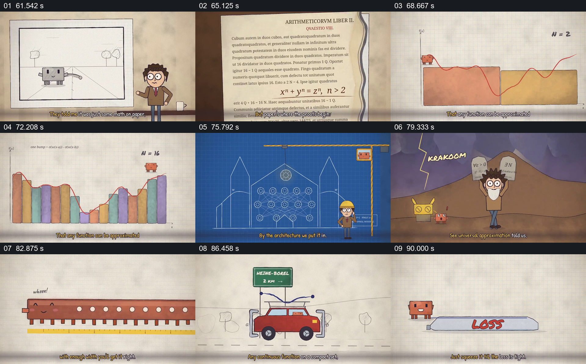

# 从纸面函数到越来越细的近似，再转成网络结构

- 作品：案例 068《线性代数与机器行为的动画叙述》（本次概括）。
- 原片范围：01:01.000–01:33.000，含起点、不含终点；[完整原片](../video.mp4)｜[本卡片段](c03.mp4)。
- 观察方式：依据整片 64 宫格和约每秒一次的真实源帧观察，未连续原速观看或听审；声音、语气与完整播放节奏未确认。

## 原画面具体怎样设计

人物先站在纸面图旁，古书页出现；红色曲线下的彩色方块从较少增至较多。蓝图中的节点网络亮起，随后节点横向增多，矩阵角色被拉长；车与曲线示意后，角色压缩写着 LOSS 的形状。

## 为什么这样设计，好在哪里

相同曲线保留为比较对象，方块数量变化让近似差异可见；网络宽度和误差图提供后续参照。数学定理和压缩隐喻不能仅由画面证明。

以上为依据画面的分析，非作者自述；预期观看效果未经观众测试。

## 可直接使用的创意指令

解释近似时，选择真实函数和误差定义，保持同一曲线作为参照，逐步增加可核对的近似项，再展示对应模型结构和误差；明确条件与限制，视觉比喻不代替证明。
