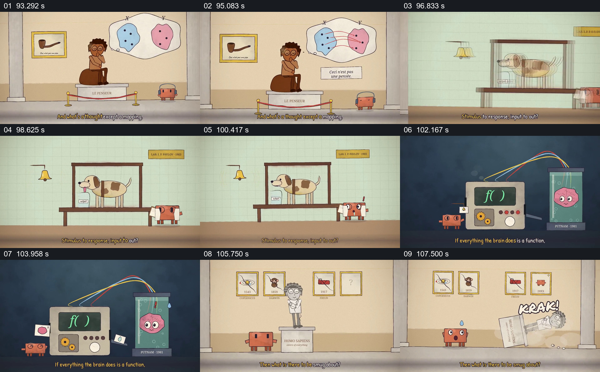

# 把思想描成映射，再连续并置动物、函数机器与人物雕像

- 作品：案例 068《线性代数与机器行为的动画叙述》（本次概括）。
- 原片范围：01:33.000–01:49.000，含起点、不含终点；[完整原片](../video.mp4)｜[本卡片段](c04.mp4)。
- 观察方式：依据整片 64 宫格和约每秒一次的真实源帧观察，未连续原速观看或听审；声音、语气与完整播放节奏未确认。

## 原画面具体怎样设计

画廊中的思考者旁出现两组点及连线；随后实验台上的狗面对铃铛，画面转到连接大脑的函数机器，最后人物雕像倒塌，墙上图像发生替换。

## 为什么这样设计，好在哪里

不同例子沿“输入与输出”并置，观众能看到观点如何跨越具体场景；雕像倒塌呈现人物对结论的情绪反应。实验、历史与意识关系未经核实。

以上为依据画面的分析，非作者自述；预期观看效果未经观众测试。

## 可直接使用的创意指令

当提出跨领域类比时，先说明每个例子的实际输入、输出及差异，再明确类比只是讨论工具；历史事件与科学推断须核查，不能凭视觉相似宣称机制相同。
