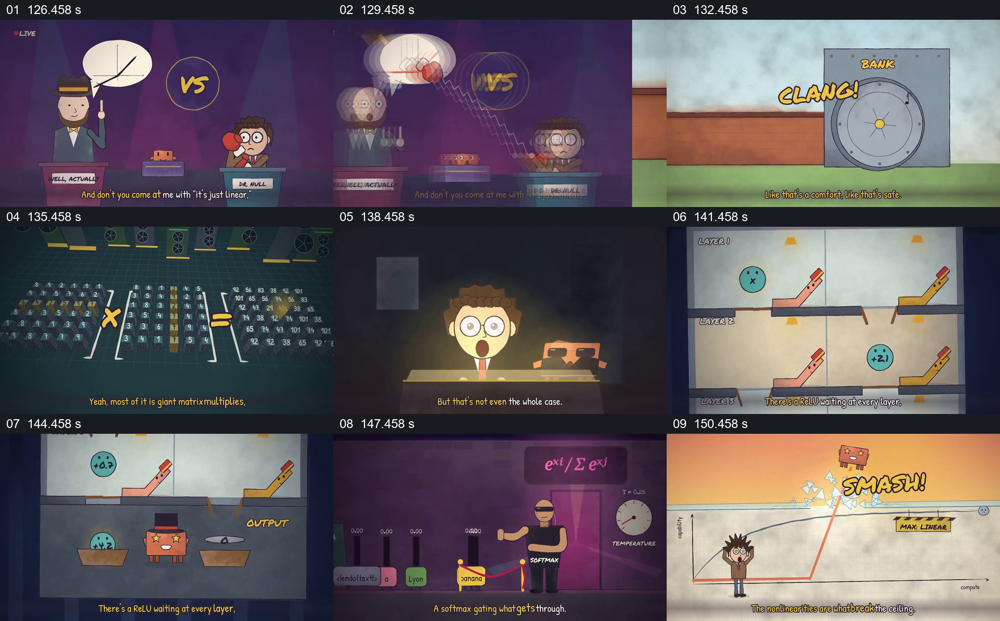

# 用门、层级和打破天花板区分线性与非线性

- 作品：案例 068《线性代数与机器行为的动画叙述》（本次概括）。
- 原片范围：02:06.000–02:33.000，含起点、不含终点；[完整原片](../video.mp4)｜[本卡片段](c05.mp4)。
- 观察方式：依据整片 64 宫格和约每秒一次的真实源帧观察，未连续原速观看或听审；声音、语气与完整播放节奏未确认。

## 原画面具体怎样设计

两名人物在辩论台前对峙；服务器与矩阵运算之后，旅馆式分层图中每层放置折线形装置。随后词语站在标有 Softmax 的门前，画面转到曲线和写有 MAX LINEAR 的线，角色向上突破该线。

## 为什么这样设计，好在哪里

门与分层让不同变换在空间中具有可辨位置，最后曲线将其与表达能力主张连接。图形是概念化表达，不能证明模型能力或公式细节。

以上为依据画面的分析，非作者自述；预期观看效果未经观众测试。

## 可直接使用的创意指令

解释多层模型时，先依据真实公式区分线性变换和非线性步骤，在层级图中给每一步明确输入输出；用可运行的例子比较结果，并标明视觉上的门和上限只是示意。
