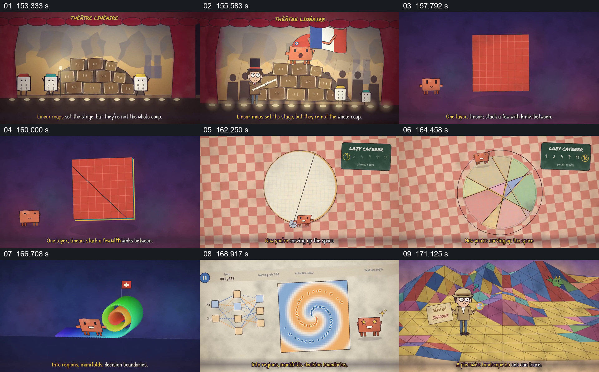

# 把空间切分从直线推进到多区域与决策图

- 作品：案例 068《线性代数与机器行为的动画叙述》（本次概括）。
- 原片范围：02:33.000–02:53.000，含起点、不含终点；[完整原片](../video.mp4)｜[本卡片段](c06.mp4)。
- 观察方式：依据整片 64 宫格和约每秒一次的真实源帧观察，未连续原速观看或听审；声音、语气与完整播放节奏未确认。

## 原画面具体怎样设计

舞台上的数字箱之后，一张网格从直线分割变为折叠形状；圆盘被多条线切成彩色区域。接着显示网络与螺旋点分类图，最后出现由多色三角面组成的地形。

## 为什么这样设计，好在哪里

同一“空间被分区”的关系从简单平面扩展到复杂图形，使抽象决策边界有具体形状。各图的数学对应关系需另行核实。

以上为依据画面的分析，非作者自述；预期观看效果未经观众测试。

## 可直接使用的创意指令

解释空间划分时，从少量可验证的点和边界开始，逐步增加真实规则并保留原参照，再展示复杂分类结果；注明示意程度，不能以视觉复杂度代替模型效果。
