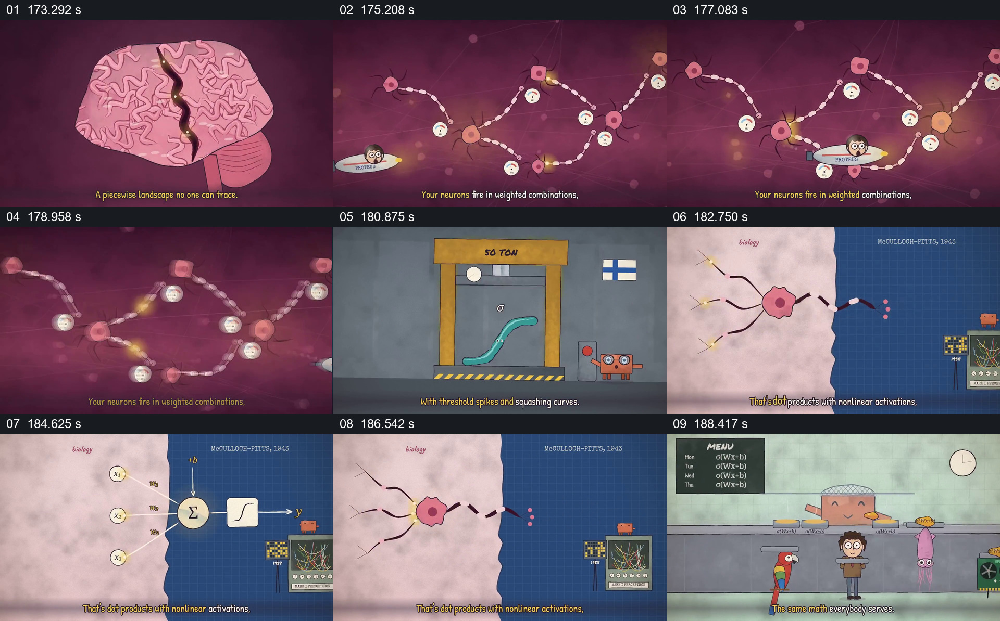

# 并置生物神经活动和人工节点示意

- 作品：案例 068《线性代数与机器行为的动画叙述》（本次概括）。
- 原片范围：02:53.000–03:10.000，含起点、不含终点；[完整原片](../video.mp4)｜[本卡片段](c07.mp4)。
- 观察方式：依据整片 64 宫格和约每秒一次的真实源帧观察，未连续原速观看或听审；声音、语气与完整播放节奏未确认。

## 原画面具体怎样设计

大脑图进入神经网络状画面，信号沿节点传递；之后出现生物实验图、被压扁的曲线，再以分屏并置神经细胞及带权重、求和和激活符号的人工节点。

## 为什么这样设计，好在哪里

先展示生物对象，再将人工计算图放到旁边，让观众看到类比所借用的关系。它们并非等同的机制，历史标签和细节未核实。

以上为依据画面的分析，非作者自述；预期观看效果未经观众测试。

## 可直接使用的创意指令

当比较生物与人工系统时，分别准确说明各自结构和条件，再突出有限的对应关系及关键差异；使用可靠科学来源，避免把图形相似当作机制或意识等价。
