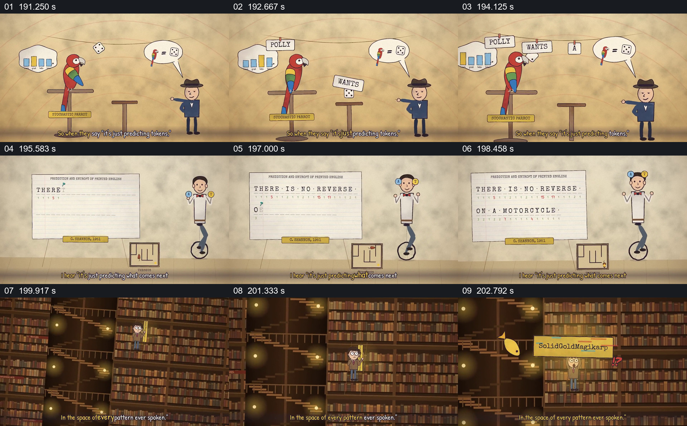

# 从逐词预测的鹦鹉到文本与图书馆

- 作品：案例 068《线性代数与机器行为的动画叙述》（本次概括）。
- 原片范围：03:11.000–03:24.000，含起点、不含终点；[完整原片](../video.mp4)｜[本卡片段](c08.mp4)。
- 观察方式：依据整片 64 宫格和约每秒一次的真实源帧观察，未连续原速观看或听审；声音、语气与完整播放节奏未确认。

## 原画面具体怎样设计

鹦鹉和人物旁词卡依次排列成句子，骰子与图表同时出现；随后纸面文字逐字显现，画面进入巨大书架，人物位于书架之间，一条词语标签被放大。

## 为什么这样设计，好在哪里

逐项词卡使序列形成过程可见，书架扩大了材料范围；这些是作品的视觉类比，不能据此推断训练数据或模型内部决策。

以上为依据画面的分析，非作者自述；预期观看效果未经观众测试。

## 可直接使用的创意指令

解释序列预测时，使用经过核对的简单概率例子，显示上下文、候选和实际选择；如用书架象征语料，清楚标明比喻，不虚构数据来源或模型访问过程。
