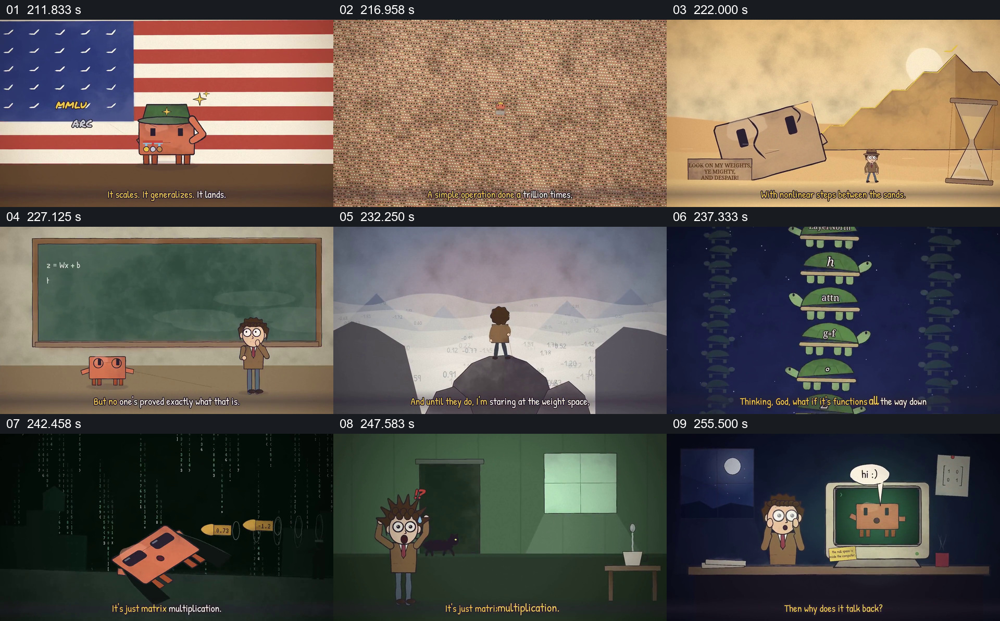

# 从重复简单运算到对意识问题的未决追问

- 作品：案例 068《线性代数与机器行为的动画叙述》（本次概括）。
- 原片范围：03:31.000–04:17.000，含起点、不含终点；[完整原片](../video.mp4)｜[本卡片段](c09.mp4)。
- 观察方式：依据整片 64 宫格和约每秒一次的真实源帧观察，未连续原速观看或听审；声音、语气与完整播放节奏未确认。

## 原画面具体怎样设计

先出现规模曲线、旗帜和月面角色，随后同一矩阵角色复制成密集阵列并转为复杂图案；大脑被放在展台上，黑板列出公式与“THEN A MIRACLE OCCURS”，人物面对由函数符号叠起的结构和数字矩阵。最后角色坐在椅子上，画面回到电脑，屏幕中的角色说“hi”。

## 为什么这样设计，好在哪里

重复与尺度扩张让简单单元和复杂整体形成视觉对照，黑板上的“奇迹”提示解释中仍有空缺；作品提出问题而非证明意识来源。具体实验、能力和观点均需独立核实。

以上为依据画面的分析，非作者自述；预期观看效果未经观众测试。

## 可直接使用的创意指令

当讨论简单规则与复杂结果时，先用真实可复现的规则及规模比较，再明确哪些现象已经观察、哪些问题仍未解决；可用重复结构表达规模，但不将复杂图案或拟人角色当作意识证据。
