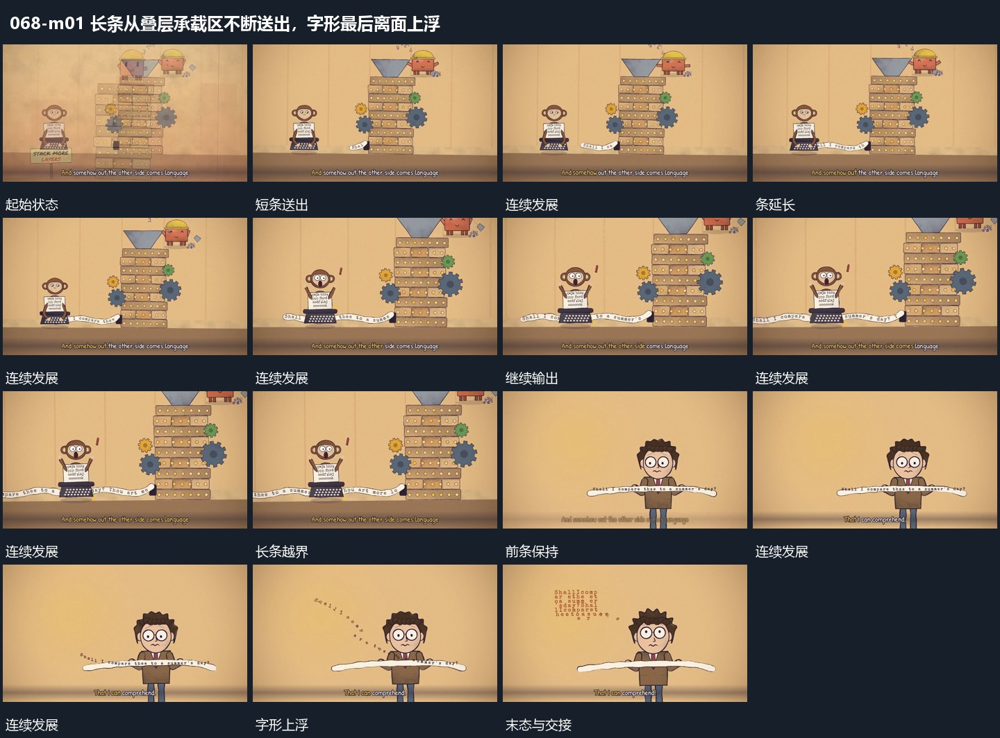

# 长条从叠层承载区不断送出，字形最后离面上浮

## 运动指令

从叠层承载区连续送出长条，条面沿侧向延伸并越过边缘，已有文字随条面经过。结束后保留一段前条，局部字形脱离条面向上浮起，形成分离字组，原条继续留在下方。

## 视频切片

[播放本机制的原片切片](m01.mp4)

覆盖分镜中“短条送出”至“更多字脱离”的连续过程，并保留邻近的前后衔接画面；原片中交叠发生的动作一并保留。

## 分镜过程

## 组合与调整

不要继承原机器主题，保留承载区到条、条到字的来源接续。
