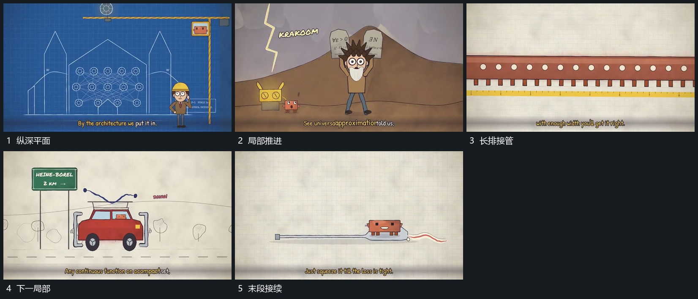

# 沿长平面纵深推进，近层扩大越界，远层接手

## 运动指令

沿长平面的纵深方向推进，近层逐渐放大越界，远层成为新的可见区域。平面内小形保持自己的相对位置，前字和短标记可在观察到的新局部接续。

## 视频切片

[播放本机制的原片切片](m03.mp4)

覆盖分镜中“纵深平面”至“末段接续”的连续过程，并保留邻近的前后衔接画面；原片中交叠发生的动作一并保留。

## 分镜过程

## 组合与调整

各示例段有素材切换，迁移时应重新建立一个连续长空间，不把原切换推定为隐藏同一模型。
