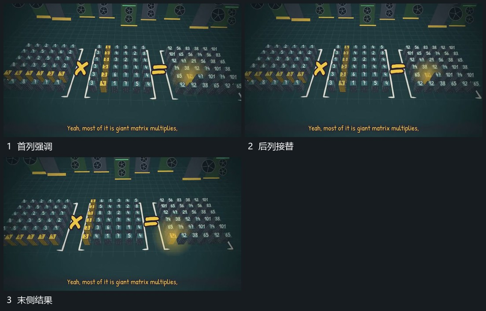

# 固定网格内局部强调逐列移动，末侧结果接续

## 运动指令

保持并置网格，把局部强调从一列转到后一列，原格与字位不动。强调到末侧后结果区接续变化，随后整组退出。

## 视频切片

[播放本机制的原片切片](m04.mp4)

覆盖分镜中“首列强调”至“末侧结果”的连续过程，并保留邻近的前后衔接画面；原片中交叠发生的动作一并保留。

## 分镜过程

## 组合与调整

源帧支持可见列间推进，不推定原计算程序。新片用自己的材料决定结果。
