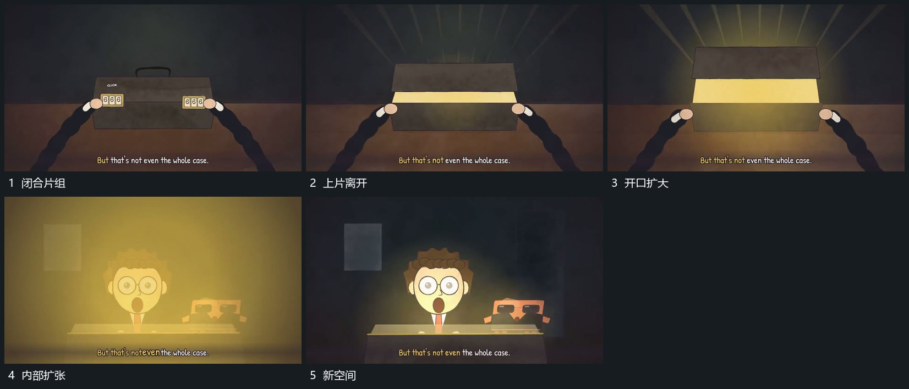

# 上片离开下片，内亮区显露并扩张接管

## 运动指令

保留下片，让上片向上离开，先露出短缝，再扩大可见内部范围。内亮区扩开到主要视野，新空间在其内接管，上下片从边缘退出。

## 视频切片

[播放本机制的原片切片](m05.mp4)

覆盖分镜中“闭合片组”至“新空间”的连续过程，并保留邻近的前后衔接画面；原片中交叠发生的动作一并保留。

## 分镜过程

## 组合与调整

不要求原箱体结构，用两片与中间揭示区也可实现。
