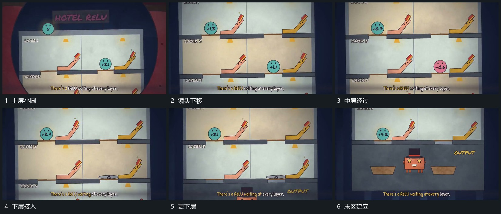

# 镜头沿多层区向下移动，小圆在层内短斜线上经过

## 运动指令

在多层承载区中让小圆沿每层短斜线经过，镜头同步向下移动。已经过上层向上退出视野，下层进入可见区并接手相同局部运动，末区最后建立。

## 视频切片

[播放本机制的原片切片](m06.mp4)

覆盖分镜中“上层小圆”至“末区建立”的连续过程，并保留邻近的前后衔接画面；原片中交叠发生的动作一并保留。

## 分镜过程

## 组合与调整

不推定所有小圆是同一颗，保持分层接续与镜头方向即可。
