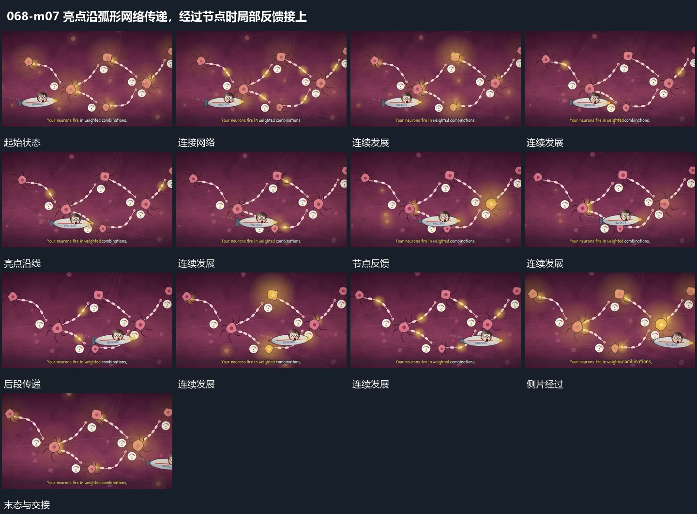

# 亮点沿弧形网络传递，经过节点时局部反馈接上

## 运动指令

保留弧形连接和固定节点，让亮点沿线传递，到节点时接入局部反馈，再继续下一段。侧方小片可以经过网络前层，节点本身不跟随亮点移动。

## 视频切片

[播放本机制的原片切片](m07.mp4)

保留起始准备、连续发展和完成或明确交接；首尾按本段运动范围裁切，不拼接、不变速。尾部只保留理解结果所需的展示。

## 分镜过程

## 组合与调整

传递方向以新片实际路径确定，不继承原神经或计算含义。
