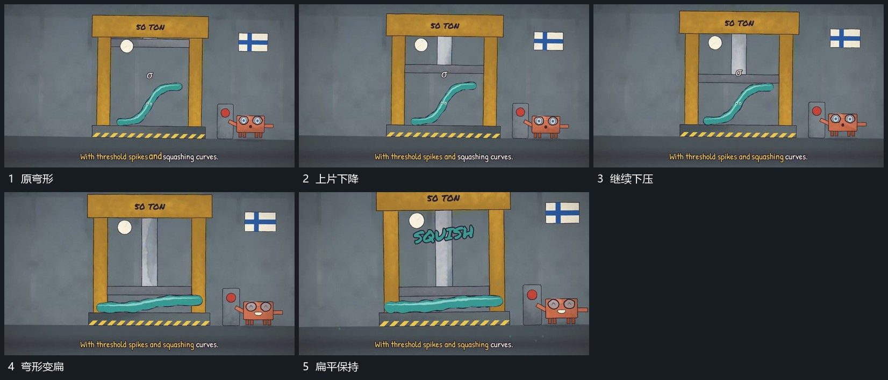

# 上片下压弯形，弯形逐渐变扁后落稳

## 运动指令

保留下部承载面，让上片沿竖向下降，逐步压缩中间弯形。弯形高度减少、横向范围增加，直到扁平落稳；上片与下片位置关系保持清楚，附属短字在完成后接入。

## 视频切片

[播放本机制的原片切片](m08.mp4)

覆盖分镜中“原弯形”至“扁平保持”的连续过程，并保留邻近的前后衔接画面；原片中交叠发生的动作一并保留。

## 分镜过程

## 组合与调整

只描述可见压缩，不推定物理材料。下形应落在两片之间。
