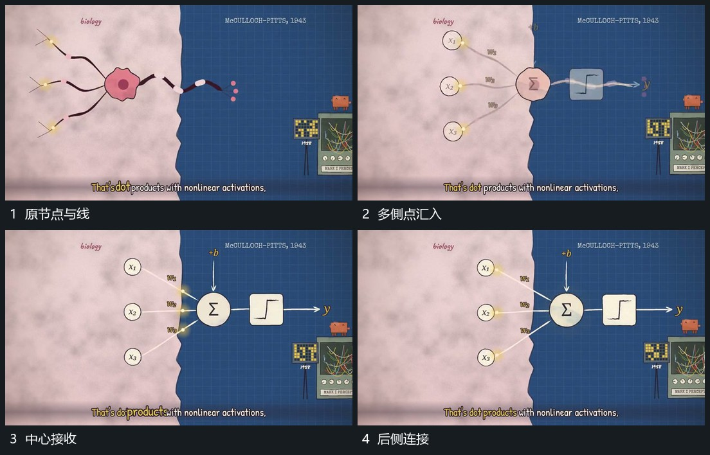

# 多侧点沿线汇到中心，后续从另一侧送出并接旁片

## 运动指令

让多侧小点沿已有线向中心汇入，中心保留并接收局部反馈。汇入阶段明确后从另一侧送出后续短线或小点，接到旁片，前连接和来源节点保持。

## 视频切片

[播放本机制的原片切片](m09.mp4)

覆盖分镜中“原节点与线”至“后侧连接”的连续过程，并保留邻近的前后衔接画面；原片中交叠发生的动作一并保留。

## 分镜过程

## 组合与调整

不执行原片公式，采用输入到中心再交给后区的运动关系。
