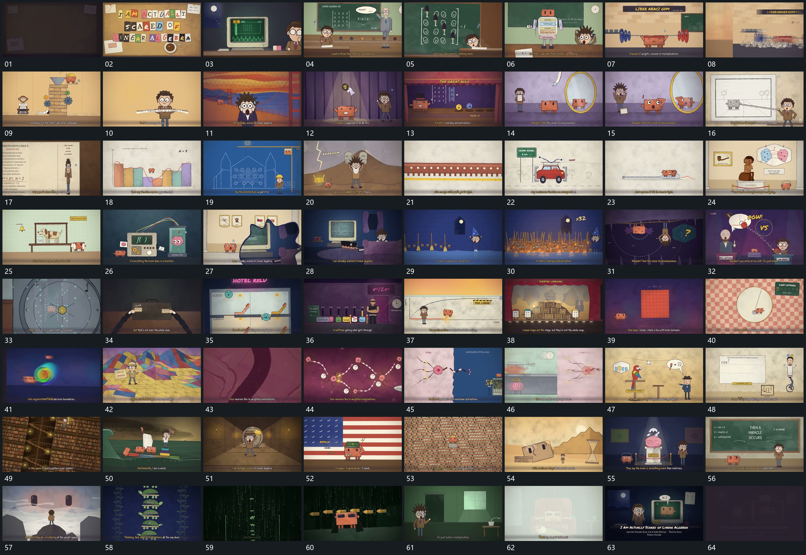

# 068｜原片运动总览

[观看完整原片](video.mp4)

## 运动总览

开头字片组建立，连续活动底层在多段之间接替，固定底字持续补齐。片内网格和悬挂小形按区增加。长条从叠层承载区不断送出，字形最后离面上浮 从叠层承载区不断送出长条，条沿侧向延伸，文字最后脱离条面上浮。随后旁组与镜面轮廓接入，多个局部短形展开，已有底层保持。

中段 宽条重分成更多窄条，高度变化贴近既有曲线 让宽条重分成更多窄条，各条高度变化贴近既有曲线，小形沿上缘经过。后续框、长排小形与旁片逐项建立；沿长平面纵深推进，近层扩大越界，远层接手 向长平面深处推近，近层放大越界。大片和小面在多段间接替，固定网格内局部强调逐列移动，末侧结果接续 从条面逐列移动局部强调，网格保持；上片离开下片，内亮区显露并扩张接管 上片离开下片，内亮区显露并扩开，交给新空间。

后段 镜头沿多层区向下移动，小圆在层内短斜线上经过 镜头沿多层承载区向下移动，层内小圆沿短斜线经过，下一层接手。并置短条和分块平面继续更新，亮点沿弧形网络传递，经过节点时局部反馈接上 在弧形连接网上沿线传递亮点，再让小片从侧方经过网络。上片下压弯形，弯形逐渐变扁后落稳 上片下压弯形，将其压成扁平后保持。随后 多侧点沿线汇到中心，后续从另一侧送出并接旁片 把多侧小点沿连接汇到中心，再从另一侧送出，接到旁片。末段片群铺满后层，镜头在密集集合中推进又拉回，数值与字片接续，最后返回稳定平面并退暗。

## 完整运动段落

以下按原片中的出现顺序引用。建立、内部发展及完成反馈放在同一段中；同时发生的局部动作与运镜写在同一份指令里。不同段之间可以是连续接管，也可以是直接切换，不能仅凭条目相邻认定可直接拼接。重复出现的同类运动采用一次连续代表范围，切片不以逐段无缝覆盖整片为目标。

1. [长条从叠层承载区不断送出，字形最后离面上浮](mechanisms/m01.md)：承载区保持，条持续侧移

2. [宽条重分成更多窄条，高度变化贴近既有曲线](mechanisms/m02.md)：曲线保持，条数增加并重调高度

3. [沿长平面纵深推进，近层扩大越界，远层接手](mechanisms/m03.md)：共同轴前进，近远依次接替

4. [固定网格内局部强调逐列移动，末侧结果接续](mechanisms/m04.md)：格位不动，局部强调移动

5. [上片离开下片，内亮区显露并扩张接管](mechanisms/m05.md)：先开缝，再上片离开，再内部扩张

6. [镜头沿多层区向下移动，小圆在层内短斜线上经过](mechanisms/m06.md)：局部经过与向下运镜接续

7. [亮点沿弧形网络传递，经过节点时局部反馈接上](mechanisms/m07.md)：沿线移动，到点反馈

8. [上片下压弯形，弯形逐渐变扁后落稳](mechanisms/m08.md)：上片持续下降，下形受限变扁

9. [多侧点沿线汇到中心，后续从另一侧送出并接旁片](mechanisms/m09.md)：先汇入，后向下一承载区送出

切片保留起始准备、必要内部停顿和完成或明确交接；首尾省略无新发展的等待，持续运动不要求人为停住。以上基于真实源帧序列和重点边界核对，不等同于全片连续声画审片。

## 完整64宫格

