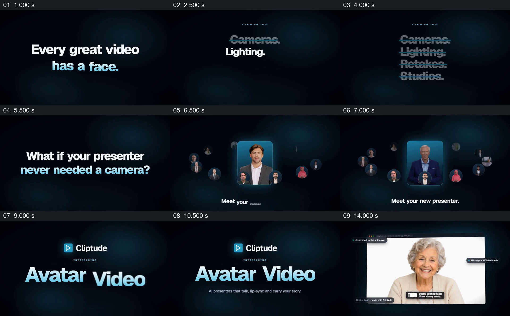

# 先划掉拍摄条件，再用人物结果回应问题

- 作品：案例 005，数字人物视频产品宣传（库内案例）。
- 原片范围：0.000–15.500 秒；[完整原片](../video.mp4)｜[本卡片段](c01.mp4)。范围为含起点、不含终点；源片末尾音视频流时长略有差异。
- 观察方式与未确认范围：查看全片 64 帧总览和本卡带源时间九宫格；未独立完成原速连续观看或听审，采样间的运动、真实节奏、声音及同步未确认。以下设计价值是依据画面作出的分析，迁移尚未实测。

## 原画面具体怎样设计

深蓝黑底上，第一句“Every great video has a face”居中，后半句用浅蓝强调。接着“Cameras、Lighting、Retakes、Studios”逐行叠在中央：后来的项目出现时，前项变暗并出现横向删除线；画面主要由字、留白和细微蓝色光晕构成，没有先给出一整张功能表。

随后问题“What if your presenter never needed a camera?”接管中央。约 6.5 秒，文字让位给居中的蓝框人物卡，其他人物缩成较小圆形分布在四周；中心人物在不同源帧中改变，周围小头像仍作为群体背景。产品标志随后居中出现，再放大“Avatar Video”及一行较小的说明。约 14 秒，界面框中的白底老妇人头像成为主体，标签环绕画面边缘，底部有作品示例文字和字幕。

## 为什么这样设计，好在哪里

先把摄像、灯光等单独摆到视线中心，再用划线形成从条件到问题的视觉递进，观众不需要先理解一张复杂界面。人物从文字问题的回答位置进入，外围小头像保留“多个人物可供选择”的集合参照，而中央大卡让注意力有明确落点；最终再由具体老妇人视频承接抽象产品名，使方案有一个可见例子。

如果只保留产品名，仍能知道这是什么宣传片，但会失去前面“为何需要它”和后面“结果长什么样”的衔接。此处只依据画面作设计分析，片中有关无需拍摄、口型同步及真实输出的说法未独立验证。

## 完整照排指令

以[完整原片](../video.mp4)的 0–15.5 秒为准。画幅 1280×720，源帧率 30/1。以下拍点为抽帧定位，位置按画幅百分比取近似值。

### 用料

- 【主句】【补句】【准备条件】【反问首行】【反问次行】【人物引见句】【产品名】【产品类别】【产品副句】各为简短文案。准备条件四条以内，能逐条划过；反问第二行负责重点色。
- 【人物预览组】需多位可辨的人像，并配至少一张竖向主肖像；【主演示片】用同一产品中的一位可实际观看的人物成品，保留一段不间断口播。主预览与实拍不必是同一人，若文案承诺某位人物结果，必须在预览和成品之间对应。另备【演示标签】【流程面板】【选择界面】【选择动作短句】，采用真实界面局部或项目自身版式，产品事实附可打开的演示或发布说明。

### 按源时刻摆放

1. **0.000–约 2.000 秒。** 近黑蓝背景，周围暗、中部晕青。中央粗白【主句】先成一行，再接浅蓝【补句】，两句居中紧排。
2. **约 2.000–4.000 秒。** 字组在中央靠上换成竖排【准备条件】，等大小近左齐。新增一项时保留前项，已划过的词压低成灰，划线横过实际字面，最下当前项仍白；最后整组退场。
3. **约 4.000–8.000 秒。** 中央对白两行【反问首行】【反问次行】先后出现，强调行偏浅青。转到人像群，主肖像在中轴偏上，青蓝方框较亮，外围小头像大小、亮度有别。【人物引见句】以小白文字在下。中心预览换一位后，为中央小标【产品名】让位，背景维持深蓝光晕。头像组用静图及轻浮动即可。
4. **约 8.000–11.000 秒。** 中轴小标下用浅青大粗【产品类别】，接更小的【产品副句】。产品名与大标题停稳，再尽退让出演示位置。
5. **约 11.000–14.000 秒。** 【主演示片】为居中大横窗，白底和主持人亮面与外侧黑蓝形成清楚对比。外窗可带轻微透视，人物仍居中。四侧灰黑圆角小标签【演示标签】绕开眼口，底部一组暗色短字幕贴近人物。演示自出现到全窗退场始终播放，禁用定格或重复口型拼接。未出现的标签不得用承诺文案补足。
6. **约 14.000–15.500 秒。** 演示窗让位给低亮度【流程面板】，后者于左至中区域展开小型选项。末尾右下斜入【选择界面】的人物多列格，附白粗【选择动作短句】。到 15.500 秒截出；仅采用人物效果可在流程面板首帧之前切。

### 局部采用

仅有反问与预览可用约 4–8 秒。仅有可连续播放的主演示可用约 11–14 秒，并保留面板外框和真实标签。

### 验证状态

已对照原片逐秒画序检查条件逐条划除、反问后人物池、标题先于主演示及尾部流程交接，并读回正文。快速过渡精确帧、原速听看和换料待核。
