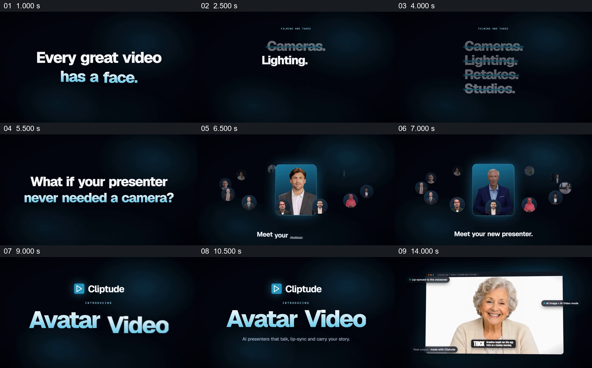

# 先划掉拍摄条件，再用人物结果回应问题

- 作品：案例 005，数字人物视频产品宣传（库内案例）。
- 原片范围：0.000–15.500 秒；[完整原片](../video.mp4)｜[本卡片段](c01.mp4)。范围为含起点、不含终点；源片末尾音视频流时长略有差异。
- 观察方式与未确认范围：查看全片 64 帧总览和本卡带源时间九宫格；未独立完成原速连续观看或听审，采样间的运动、真实节奏、声音及同步未确认。以下设计价值是依据画面作出的分析，迁移尚未实测。

## 原画面具体怎样设计

深蓝黑底上，第一句“Every great video has a face”居中，后半句用浅蓝强调。接着“Cameras、Lighting、Retakes、Studios”逐行叠在中央：后来的项目出现时，前项变暗并出现横向删除线；画面主要由字、留白和细微蓝色光晕构成，没有先给出一整张功能表。

随后问题“What if your presenter never needed a camera?”接管中央。约 6.5 秒，文字让位给居中的蓝框人物卡，其他人物缩成较小圆形分布在四周；中心人物在不同源帧中改变，周围小头像仍作为群体背景。产品标志随后居中出现，再放大“Avatar Video”及一行较小的说明。约 14 秒，界面框中的白底老妇人头像成为主体，标签环绕画面边缘，底部有作品示例文字和字幕。

## 为什么这样设计，好在哪里

先把摄像、灯光等单独摆到视线中心，再用划线形成从条件到问题的视觉递进，观众不需要先理解一张复杂界面。人物从文字问题的回答位置进入，外围小头像保留“多个人物可供选择”的集合参照，而中央大卡让注意力有明确落点；最终再由具体老妇人视频承接抽象产品名，使方案有一个可见例子。

如果只保留产品名，仍能知道这是什么宣传片，但会失去前面“为何需要它”和后面“结果长什么样”的衔接。此处只依据画面作设计分析，片中有关无需拍摄、口型同步及真实输出的说法未独立验证。

## 可直接使用的创意指令

适合介绍一种需要替代原有流程的工具或服务。先选观众熟悉的两三项真实限制，分次呈现并在每次进入新项目时保留之前的痕迹；再以一个明确问题转到替代方案。答案出现时，先用一组候选显示可选范围，同时把一个具体对象放到主视觉位置，随后用真实或清楚标注的演示结果证明观众接下来要看什么。

颜色、人物数量、排印和列表形式均可按新内容调整；需要保留“已知条件—提出问题—具体回应”的关系，并让示例与问题有关。功能承诺必须有相应依据；静态展示不能证明实际效果或口型同步。
