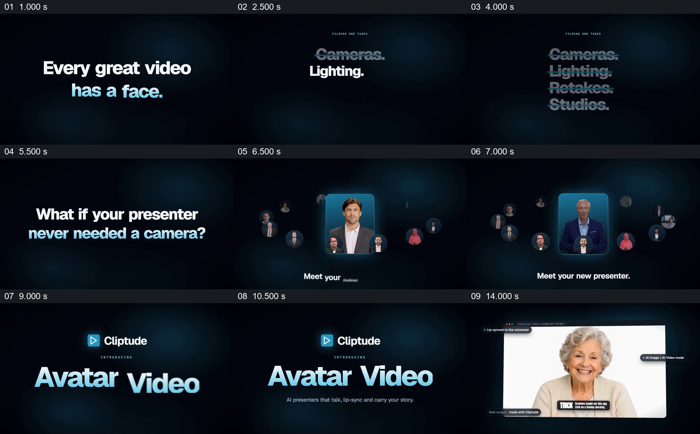

# 先逐项划掉拍摄负担，再给出数字人物示例

- 作品：案例 005《数字人画面与产品介绍》（索引名称）。
- 原片范围：00:00.000–00:15.500，含起点、不含终点；[完整原片](../video.mp4)｜[本卡完整片段](c01.mp4)。
- 观察方式：按整片 64 宫格和约每秒一个原片帧观察全片，并选取下方九个源帧；未连续原速观看或听审，声音、口型同步及语气保持未知。

## 原画面具体怎样设计

深色背景先显示“Every great video has a face.”，接着 Cameras、Lighting、Retakes、Studios 等词逐项出现并被划线。画面问“如果讲述者不需要摄像机呢”，人物头像环绕中央人物卡出现；随后产品名称 Avatar Video 和说明显现，再接到一位年长女性的正面人物视频，周围标出配音口型和图像加视频模式。

## 为什么这样设计，好在哪里

拍摄清单先给抽象的问题具体项目，后面的提问和人物示例共同回应这个开场；人物从头像卡走到较大的示例窗口，使所谓替代方案有可观看的形态。拍摄负担与产品能力是原片宣传说法，静帧不能证明示例口型、生成方式或实际效果。 这是基于画面的作品分析，不代表作者自述或已测量的观众反应。

## 可直接使用的创意指令

当产品确实面向某一工作负担时，先列出与目标观众相关、可核实的具体环节，用清楚的视觉变化说明哪些环节被改变；再提出与产品相关的问题，展示能够对应问题的真实结果。为人物或成果保留足够观看空间，必要时注明素材与处理方式；不把宣传示例当作所有场景都能得到同样效果的证据。
