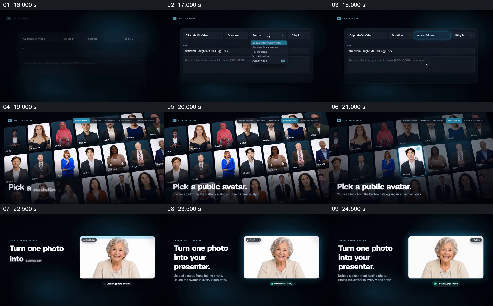

# 从人物目录的选择，接到一张照片成为人物的另一条路径

- 作品：案例 005，数字人物视频产品宣传（库内案例）。
- 原片范围：15.500–25.200 秒；[完整原片](../video.mp4)｜[本卡片段](c02.mp4)。范围为含起点、不含终点；源片末尾音视频流时长略有差异。
- 观察方式与未确认范围：查看全片 64 帧总览和本卡带源时间九宫格；未独立完成原速连续观看或听审，采样间的运动、真实节奏、声音及同步未确认。以下设计价值是依据画面作出的分析，迁移尚未实测。

## 原画面具体怎样设计

从 15.5 秒附近开始，暗色产品界面展示格式、标题输入与下拉选项；“Avatar Video”在格式栏中成为选中项。随后界面变成占满主要画面的倾斜人物目录，多行人物卡带姓名，顶部标签区分内置与公共人物；光标所在人物卡变亮、加蓝色边框及选中标记，其他卡片变暗。底部“Pick a public avatar”承接这一次选择。

约 22.5 秒转入另一套左右构图：左侧标题写“Turn one photo into your presenter”，右侧是一张白底老妇人照片，带文件名；照片下方状态由创建中变为绿色“ready”，后续画面右上出现“Talking”标签。前一段是从人群挑一个，后一段以同一张照片保持参照，展示另一种输入到就绪的可见状态。

## 为什么这样设计，好在哪里

人物墙先用数量回答“有谁可以选”，再让单一卡片提亮，观众无需逐个读完姓名即可知道选中对象。照片路径则把说明放左侧、输入与状态放右侧，让文字主张旁边始终有具体例子；由创建状态到就绪标签的变化，交代了这一条路径的结果。

两种路径分别使用不同的画面结构，避免把“选现成”与“从照片建立”挤在同一张不可读的大界面。源帧只能证明这些画面和状态显示过，无法确认真实处理过程或照片人物实际说话的声画同步。

## 可直接使用的创意指令

当一个产品或工作流程有“从现成集合选择”和“用用户材料建立”两种合法路径时，先以足够清楚的候选集合呈现前者，再通过尺寸、亮度或标记指认具体选中项；保留少量未选候选作为参照。随后让一份可辨认的输入材料与处理状态同画，并在不丢失该输入身份的情况下显示结果，方便观众理解两条路径的差别。

可以替换人物、目录、照片和色彩；要保留选择关系与输入到结果的因果展示。真实功能、授权和处理结果应可核验；若只能提供概念模拟，应明确说明。
