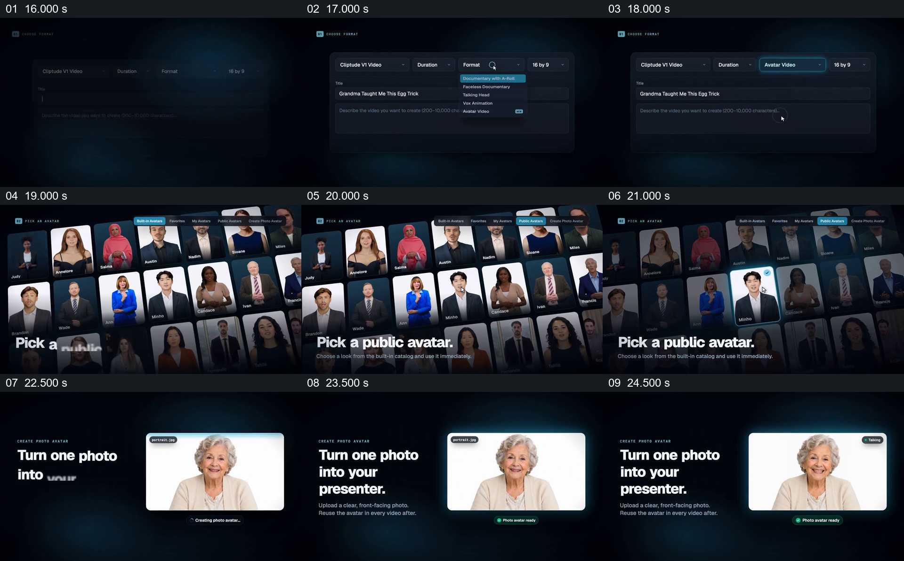

# 把内置人物选择和照片人物制作并排成两条路线

- 作品：案例 005《数字人画面与产品介绍》（索引名称）。
- 原片范围：00:15.500–00:25.200，含起点、不含终点；[完整原片](../video.mp4)｜[本卡完整片段](c02.mp4)。
- 观察方式：按整片 64 宫格和约每秒一个原片帧观察全片，并选取下方九个源帧；未连续原速观看或听审，声音、口型同步及语气保持未知。

## 原画面具体怎样设计

视频先显示新建界面和格式下拉框，选择 Avatar Video 后，切到铺满屏幕的人物目录，文字提示选择公共人物；一个人物卡被突出。随后另一个版面写“Turn one photo into your presenter.”，年长女性照片上出现扫描线，状态从创建中变为人物已就绪。

## 为什么这样设计，好在哪里

目录与单张照片使用两种不同的空间组织：大量卡片表示选择，单张大图表示从个人照片开始。两者共享人物视频的目标，却让输入方式的区别直接可见。扫描线和状态标签是作品中的界面表现，不能单凭画面证明真实生成过程或人物授权。 这是基于画面的作品分析，不代表作者自述或已测量的观众反应。

## 可直接使用的创意指令

当同一个成果可以从不同真实输入开始时，先明确共同目标，再分别展示每条路线的起点、必要操作和可见结果；让路线在布局上可区分，同时保持产品身份与输出关系一致。使用人物照片时须有相应授权；录屏、示意画面和实际生成结果应清楚区分，不以动画状态代替功能验证。
