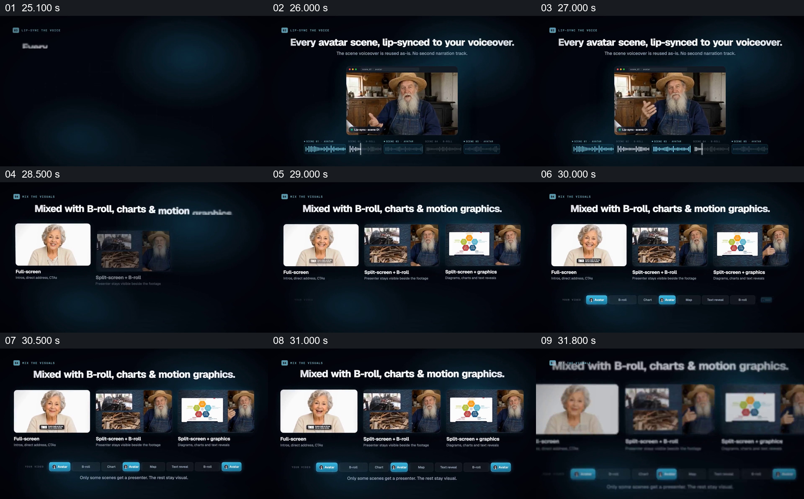

# 用同一个时间线说明人物与其他画面的三种组合

- 作品：案例 005，数字人物视频产品宣传（库内案例）。
- 原片范围：25.000–32.000 秒；[完整原片](../video.mp4)｜[本卡片段](c03.mp4)。范围为含起点、不含终点；源片末尾音视频流时长略有差异。
- 观察方式与未确认范围：查看全片 64 帧总览和本卡带源时间九宫格；未独立完成原速连续观看或听审，采样间的运动、真实节奏、声音及同步未确认。以下设计价值是依据画面作出的分析，迁移尚未实测。

## 原画面具体怎样设计

约 25 秒，深色底上方出现关于人物场景和旁白的标题，中央是一名戴帽老人的横向画面，画面下排列数段小波形，部分块标记“AVATAR”，其他块标记“B-ROLL”；不同位置的竖线和亮块在源帧中发生变化。这里波形与人物窗口共同构成时间线式说明，而不是孤立的人物特写。

约 28.5 秒，标题变成“Mixed with B-roll, charts & motion graphics”。下面并排三张示意：左边老妇人白底全屏，中间是老人靠右、左边并列实景素材，右边是老人靠右、图表在左。到 30 秒下方又出现一串 Avatar、B-roll、Chart、Map、Text reveal 等小块，人物块以蓝色突出，其余块维持深色，构成有主讲也有非人物画面的整条视频示意。

## 为什么这样设计，好在哪里

顶部人物窗口和底部波形让观众先理解主讲与段落有对应关系；三张示例则把“人物不是一直占满画面”展开为可直接比较的构图。老人同时出现在两个分屏示例一侧，使人物位置成为可追踪的参照；旁边材料分别承担环境和图形说明，而不是只靠标签区别布局。

底部的排列条把这三幅局部画面重新接回一段视频，说明不同画面可以在整片中交替。抽帧没有验证旁白与口型的实际对应，也不能证明这些示意属于同一个声音片段。

## 可直接使用的创意指令

适合主讲内容既需要人物在场，也需要观众看清实际材料或解释图形。准备一个可辨认的主讲对象、需要他解释的实景或图形，以及能够代表视频段落的时间线；先建立人物与内容段的关系，再并列展示全屏主讲、人物与实景并置、人物与图形并置等确有必要的构图。

让不同示例中的人物保持足够稳定的身份或位置，素材负责带来内容变化；最后以段落顺序说明哪些地方回到人物，哪些地方由其他材料承担主要画面。示例数量、版式、人物位置和线性排列方式可调整；不要暗示人物和素材必须始终同时出现，声音同步需单独核实。
