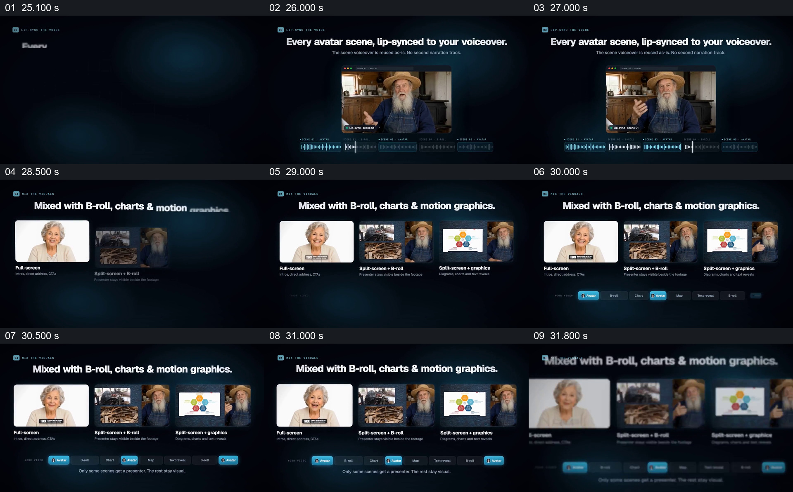

# 以同一讲述片段展示人物与其他画面的三种组合

- 作品：案例 005《数字人画面与产品介绍》（索引名称）。
- 原片范围：00:25.000–00:32.000，含起点、不含终点；[完整原片](../video.mp4)｜[本卡完整片段](c03.mp4)。
- 观察方式：按整片 64 宫格和约每秒一个原片帧观察全片，并选取下方九个源帧；未连续原速观看或听审，声音、口型同步及语气保持未知。

## 原画面具体怎样设计

标题写每个人物场景与配音口型同步，中央是戴帽长者的人物窗口，下方有分段波形与时间线。接着出现三个并排样例：全屏人物、人物旁的实景画面，以及人物旁的图形；下方时间线以不同块显示人物与其他场景的穿插。

## 为什么这样设计，好在哪里

先给一个人物和时间线的共同参照，再将三种构图并排，观众可以把区别落到人物与素材的实际空间关系。底部序列补充说明人物不是必须覆盖每一段；画面宣称的口型同步需要实际声画核对，静帧无法证实。 这是基于画面的作品分析，不代表作者自述或已测量的观众反应。

## 可直接使用的创意指令

当同一主体需要与其他材料共同讲述时，先建立主体和内容节奏，再准备目的相同但空间关系不同的完整示例，例如主体全屏、主体与实景并置、主体与图解并置。并排比较时保留可辨认的画面和简短用途说明，必要时用序列说明不同形式何时交替。声音、授权和同步需用实际成片检查，示意时间线不能替代播放验证。
