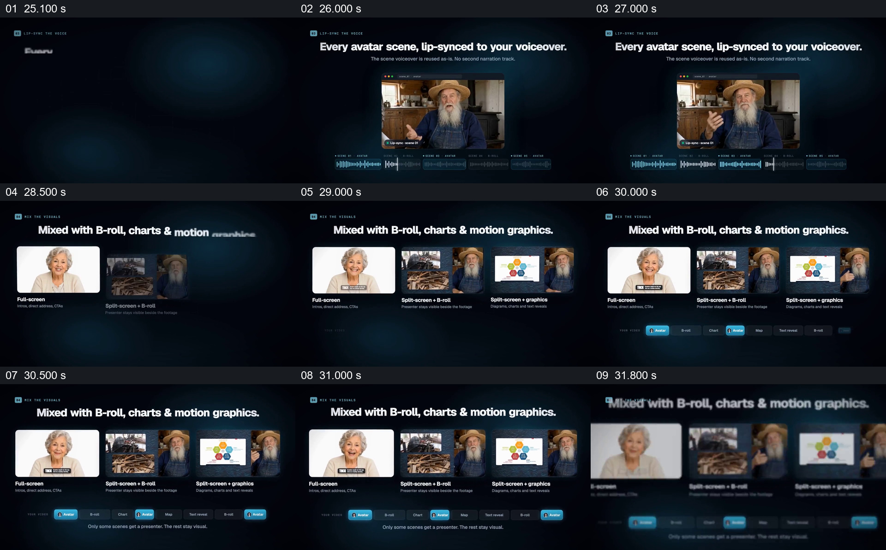

# 用同一个时间线说明人物与其他画面的三种组合

- 作品：案例 005，数字人物视频产品宣传（库内案例）。
- 原片范围：25.000–32.000 秒；[完整原片](../video.mp4)｜[本卡片段](c03.mp4)。范围为含起点、不含终点；源片末尾音视频流时长略有差异。
- 观察方式与未确认范围：查看全片 64 帧总览和本卡带源时间九宫格；未独立完成原速连续观看或听审，采样间的运动、真实节奏、声音及同步未确认。以下设计价值是依据画面作出的分析，迁移尚未实测。

## 原画面具体怎样设计

约 25 秒，深色底上方出现关于人物场景和旁白的标题，中央是一名戴帽老人的横向画面，画面下排列数段小波形，部分块标记“AVATAR”，其他块标记“B-ROLL”；不同位置的竖线和亮块在源帧中发生变化。这里波形与人物窗口共同构成时间线式说明，而不是孤立的人物特写。

约 28.5 秒，标题变成“Mixed with B-roll, charts & motion graphics”。下面并排三张示意：左边老妇人白底全屏，中间是老人靠右、左边并列实景素材，右边是老人靠右、图表在左。到 30 秒下方又出现一串 Avatar、B-roll、Chart、Map、Text reveal 等小块，人物块以蓝色突出，其余块维持深色，构成有主讲也有非人物画面的整条视频示意。

## 为什么这样设计，好在哪里

顶部人物窗口和底部波形让观众先理解主讲与段落有对应关系；三张示例则把“人物不是一直占满画面”展开为可直接比较的构图。老人同时出现在两个分屏示例一侧，使人物位置成为可追踪的参照；旁边材料分别承担环境和图形说明，而不是只靠标签区别布局。

底部的排列条把这三幅局部画面重新接回一段视频，说明不同画面可以在整片中交替。抽帧没有验证旁白与口型的实际对应，也不能证明这些示意属于同一个声音片段。

## 完整照排指令

以[完整原片](../video.mp4)的 25–32 秒为准。画幅 1280×720，源帧率 30/1。以下拍点为抽帧定位，位置按画幅百分比取近似值。

### 用料

- 【口播示例】备横向镜头，中部能看清主讲人，需要约三秒连续对口型的可辨动作。【分段波形】取同一镜头采用的实际配音，分段与对白停顿对应。另备【口播标题】【口播副句】与【组合标题】，每项一条短句。
- 【全屏讲述】【分屏讲述】【实景切画】【图形切画】用于三个等大的示例窗。两组分屏右侧应复用同一段【分屏讲述】或同一讲述者的对应段，左侧分别为主题相关的实拍与图形。为三窗各备一行【组合标签】和一行较小【组合说明】，另备【时间标记】与可接下卡的【下一场画面】和【下一场首词】。若声称是某工作流的实际输出，保留可复查的输入、配音源段与导出结果。

### 按源时刻摆放

1. **25.000–约 28.000 秒。** 近黑蓝、中心轻微青光，靠上从左以白粗一行排【口播标题】，下接更小的浅色【口播副句】。主窗【口播示例】置中，约占画宽四成，人物和身后温暖环境可辨。窗下贴几段青蓝【分段波形】，按实际对白时钟依次显现或提亮，段间黑缝保留。在最后一段波形出现前人物仍继续播放，禁用静照替代口型。
2. **约 28.000–29.000 秒。** 整体交给【组合标题】，上方左齐，保持白粗字。其下由左至右建立三等宽横窗，x5% 至 x95%、窗间留两道暗缝，整体在画面中部。首窗【全屏讲述】以明亮浅色背景填满；中窗左侧【实景切画】右侧【分屏讲述】；末窗左侧【图形切画】右侧同名【分屏讲述】。两组分屏都留明确竖缝，右侧人物等宽等高，便于辨认换的是左画面。每窗下紧排同名【组合标签】与小一档【组合说明】。
3. **约 29.000–31.800 秒。** 完成三窗后，在其下的同一条暗细时间带上从左到右加浅青小【时间标记】，同时保留窗、标题、说明与底部极小注记。各窗从各自入场到整体切出保持取景；使用动态样片时备至少可覆盖各自两至三秒的连续段，两个右半保持同相位，不循环口型。若仅用于版式说明，可将三窗一起定格为静态样张并沿用时间带表现布局。禁止先移走首窗再建立后两窗。
4. **约 31.800–32.000 秒。** 深色三窗退场，【下一场画面】满屏出现，左中叠白粗【下一场首词】。按 32.000 秒切出。只用三种组合比较时，在满屏换景前结束。

### 局部采用

有对口型片和真实波形时可用约 25–28 秒。两组材料各有匹配时可用约 28–31.8 秒的三窗比较。缺任一分屏的左侧材料时只采用单窗对应拍，不冒充完整三种组合。

### 验证状态

已对照原片每秒两帧画序并读回。核对人物窗下分段波形增加、三个窗从左至右并排及时间标记在三窗都留下后继续出现。两组分屏内的精确播放相位、逐帧切点、原速听看与实际换料待核。
