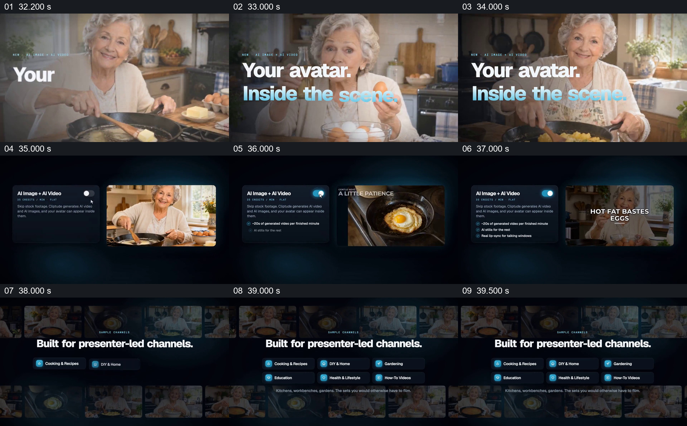

# 先让人物进入具体场景，再展示适用内容类型

- 作品：案例 005《数字人画面与产品介绍》（索引名称）。
- 原片范围：00:32.000–00:40.000，含起点、不含终点；[完整原片](../video.mp4)｜[本卡完整片段](c04.mp4)。
- 观察方式：按整片 64 宫格和约每秒一个原片帧观察全片，并选取下方九个源帧；未连续原速观看或听审，声音、口型同步及语气保持未知。

## 原画面具体怎样设计

年长女性在厨房里处理食物的画面占据全屏，文字写“Your avatar. Inside the scene.”。之后左侧是 AI Image + AI Video 的开关与说明，右侧窗口依次显示人物和煎蛋画面；最后背景铺开不同画面缩略图，前景列出烹饪、家居、园艺、教育等频道类型。

## 为什么这样设计，好在哪里

先给出一个具体厨房情境，再回到选项和内容类别，功能不只停留在抽象按钮上；多种类型卡片把单个烹饪例子扩展到作品声称的适用范围。场景来源、人物生成和这些类别的实际可用性均不能仅凭展示确认。 这是基于画面的作品分析，不代表作者自述或已测量的观众反应。

## 可直接使用的创意指令

当要解释某种主体如何进入内容场景时，先选一个与观众任务相关的完整示例，让主体、环境和正在发生的活动同时可辨；再说明相关设置，并以少量具体类别提示可迁移的使用范围。示例要说明是实际素材、生成结果还是示意，分类只能覆盖已支持的场景，不以单个演示保证所有场景的质量。
