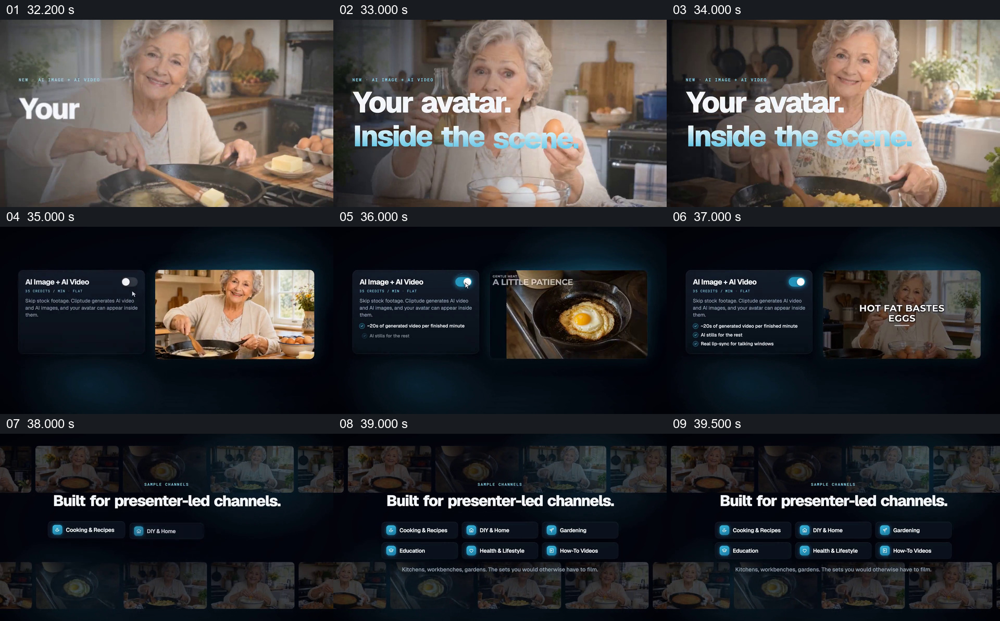

# 先把人物放进环境，再用同组画面说明可覆盖的内容类型

- 作品：案例 005，数字人物视频产品宣传（库内案例）。
- 原片范围：32.000–40.000 秒；[完整原片](../video.mp4)｜[本卡片段](c04.mp4)。范围为含起点、不含终点；源片末尾音视频流时长略有差异。
- 观察方式与未确认范围：查看全片 64 帧总览和本卡带源时间九宫格；未独立完成原速连续观看或听审，采样间的运动、真实节奏、声音及同步未确认。以下设计价值是依据画面作出的分析，迁移尚未实测。

## 原画面具体怎样设计

约 32 秒，画面由前一组小示例转为厨房大画面：老妇人在料理台后，前景是锅、黄油和鸡蛋，后方有橱柜、厨具和窗户。连续抽样中可见她持锅铲、展示鸡蛋、搅拌等不同状态；“Your avatar. Inside the scene.”覆盖在人物和厨房之间，其中后半句用浅蓝强调。

随后深色底上出现左右两块：左侧是“AI Image + AI Video”设置卡与开关，右侧是厨房样片；开关变亮后，右侧依次出现锅中煎蛋的近景和带画内字的老妇人画面。约 38 秒，几张厨房图像缩成画面上下两条暗色横带，中间标题写“Built for presenter-led channels”，其下排列烹饪、家居、园艺、教育等类别标签。

## 为什么这样设计，好在哪里

先让人物、手中食材和真实感环境共同占据画面，观众看到的是一项正在发生的活动，不仅是人物贴在空背景前。随后同一主题的全景、食物细节与文字镜头进入小窗口，让左侧的功能选项有可观察的结果；人物与环境的关系保持为阅读核心。

结尾把刚才的具体画面缩为上下背景，类别标签进入中央，形成从一个实例扩展到适用类型的阅读顺序。它能表达作品的宣传意图，但画面本身不能证明素材全部由该功能生成，或不同类别均已得到同等验证。

## 完整照排指令

以[完整原片](../video.mp4)的 32–40 秒为准。画幅 1280×720，源帧率 30/1。以下拍点为抽帧定位，位置按画幅百分比取近似值。

### 用料

- 【厨房主镜】【动作俯拍】【环境近景】取同一人物、同一组厨具与同一烹调过程，保留可辨的食材和手部动作。另备【类别样片组】，用多个可辨应用场景的小片段支撑【类别名称】。同一烹调片可以同时出现在示例和样片墙中。
- 【主标题】【副标题】【开关字段】【开关说明】【示例短字】【类别总句】【邻段标题】【邻段字段】按真实产品能力填写。需要证明开关效果时，取同一输入的前后结果和可打开的操作记录，保留相同取景、声音与流程阶段，说明演示条件。

### 按源时刻摆放

1. **32.000–约 34.500 秒。** 【厨房主镜】满铺，人物头肩在中部稍偏右，手和锅在底半，器物沿暖色后墙布置。左半由暗细渐层托白粗【主标题】，下方用同级浅青【副标题】，两行逐词立起。选连续镜头或同动作匹配角度，保留手与食材实际接触，至下一拍缩进横窗，不用静照运镜代替烹调。
2. **约 34.500–37.000 秒。** 深黑蓝背景接管；同场【厨房主镜】缩为右边圆角横窗，左边空出一块暗灰控制板，左上小白【开关字段】、旁边或右端一个小滑钮。钮先灰后青，板内小白【开关说明】逐步补齐。右窗随后切【动作俯拍】和【环境近景】，白色短粗【示例短字】放到相应镜头的安全空位。右窗从出现至整组退场一直播放，镜头可切而锅和食材关系持续，禁止用循环或冻结伪造烹调进展。
3. **约 37.000–39.200 秒。** 退掉控制板，把【类别样片组】在画顶及底部分成暗色横条，裁切边缘；中心保留黑蓝空带。白粗【类别总句】位于中上，其下浅蓝小图标与短白【类别名称】分成近三列，上排先到，再补下排。上下样片视觉上仍同场保留，不能让类别盖住整屏样片。外围仅承担浏览层时可用静帧或无缝循环，和类别直接对应的动态需可见。
4. **约 39.200–40.000 秒。** 样片条与类别退出，深底上左齐出现【邻段标题】，下方小暗卡开始填入【邻段字段】。按 40.000 秒切出。独立采用类别段时，在邻段标题首次出现前切。

### 局部采用

只有人物烹调可用 32–约 34.500 秒。若有同源前后效果，约 34.500–37.000 秒可独立作控制示例；只有类别资料则采用约 37.000–39.200 秒。

### 验证状态

已对照每秒两帧原片画序并读回，核对左文右人、开关状态与烹调变化同场、类别行逐批展开。更细切点、开关因果、原速听看及换料待核。
