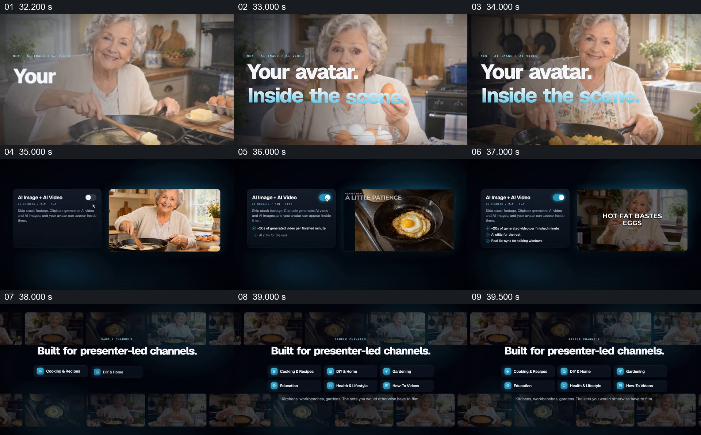

# 先把人物放进环境，再用同组画面说明可覆盖的内容类型

- 作品：案例 005，数字人物视频产品宣传（库内案例）。
- 原片范围：32.000–40.000 秒；[完整原片](../video.mp4)｜[本卡片段](c04.mp4)。范围为含起点、不含终点；源片末尾音视频流时长略有差异。
- 观察方式与未确认范围：查看全片 64 帧总览和本卡带源时间九宫格；未独立完成原速连续观看或听审，采样间的运动、真实节奏、声音及同步未确认。以下设计价值是依据画面作出的分析，迁移尚未实测。

## 原画面具体怎样设计

约 32 秒，画面由前一组小示例转为厨房大画面：老妇人在料理台后，前景是锅、黄油和鸡蛋，后方有橱柜、厨具和窗户。连续抽样中可见她持锅铲、展示鸡蛋、搅拌等不同状态；“Your avatar. Inside the scene.”覆盖在人物和厨房之间，其中后半句用浅蓝强调。

随后深色底上出现左右两块：左侧是“AI Image + AI Video”设置卡与开关，右侧是厨房样片；开关变亮后，右侧依次出现锅中煎蛋的近景和带画内字的老妇人画面。约 38 秒，几张厨房图像缩成画面上下两条暗色横带，中间标题写“Built for presenter-led channels”，其下排列烹饪、家居、园艺、教育等类别标签。

## 为什么这样设计，好在哪里

先让人物、手中食材和真实感环境共同占据画面，观众看到的是一项正在发生的活动，不仅是人物贴在空背景前。随后同一主题的全景、食物细节与文字镜头进入小窗口，让左侧的功能选项有可观察的结果；人物与环境的关系保持为阅读核心。

结尾把刚才的具体画面缩为上下背景，类别标签进入中央，形成从一个实例扩展到适用类型的阅读顺序。它能表达作品的宣传意图，但画面本身不能证明素材全部由该功能生成，或不同类别均已得到同等验证。

## 可直接使用的创意指令

当需要展示一个人物如何在某个环境中承担讲述或操作，先选一段能看到人物、环境和对象相互关系的材料：使其手部动作、工具及结果在同一构图里可辨。再把相应的界面选项或说明放到旁边，保留该场景的小预览，适当切入可说明动作结果的局部，而不是只给抽象功能名称。

如需扩展到其他使用范围，可把已看过的实例退到背景，将有依据的类别放在前景；前景类别需与可提供的材料相符。人物、场景、选项和背景排列可变，关键是观众先看到具体人、动作和环境如何共同成立，再理解扩展范围。
