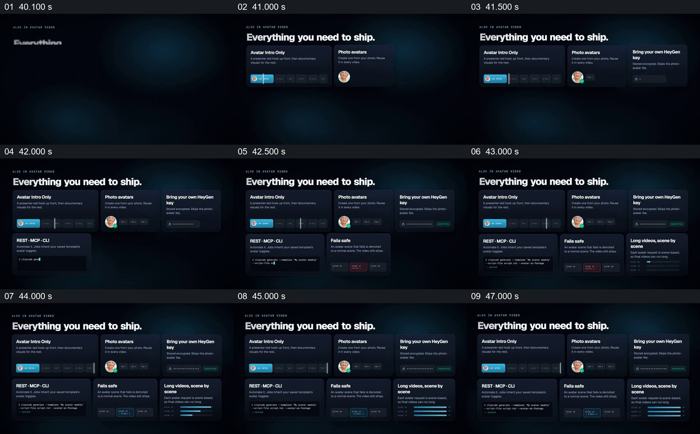

# 逐张积累带小示意的功能卡，最后留下可比较的整体

- 作品：案例 005，数字人物视频产品宣传（库内案例）。
- 原片范围：40.000–48.000 秒；[完整原片](../video.mp4)｜[本卡片段](c05.mp4)。范围为含起点、不含终点；源片末尾音视频流时长略有差异。
- 观察方式与未确认范围：查看全片 64 帧总览和本卡带源时间九宫格；未独立完成原速连续观看或听审，采样间的运动、真实节奏、声音及同步未确认。以下设计价值是依据画面作出的分析，迁移尚未实测。

## 原画面具体怎样设计

约 40 秒，深色蓝光背景中央上方出现“Everything you need to ship.”；其下先出现头像开场和照片人物等功能卡，卡片都有简短标题、正文及小型示意。随后右侧和第二行逐步补齐密钥、命令接口、失败处理以及分场景长视频等卡，最后形成三列两行。

每张卡的内部示意不同：第一张是一串段落块，照片卡有小圆头像与多个输出位置，密钥卡有输入及状态标识，命令卡是深色代码窗口，失败卡有几块场景状态，长视频卡有横向进度条。已出现的卡片在后续源帧中留在网格里，新卡填入空位；小型示意的状态也在不同帧中发生变化。

## 为什么这样设计，好在哪里

大标题先定义这是一个能力集合，分批建立使注意力可以依次落到新卡，而不是首次就面对六组细字。已建立卡片不随新卡消失，因此到最后观众能同时看到能力清单；每项都有属于自己的微型对象，帮助区分“人物开头”“状态处理”和“多个场景”等不同工作。

这些内部界面只是表达功能的可见示意，并不足以验证功能可用性。截图无法确定每张卡的真实停顿与小动画是否同时播放，效果分析依赖其可见的累积关系。

## 完整照排指令

以[完整原片](../video.mp4)的 40–48 秒为准。画幅 1280×720，源帧率 30/1。以下拍点为抽帧定位，位置按画幅百分比取近似值。

### 用料

- 【总标题】【标题眉字】各一短行。【功能名称】【功能说明】【功能示意】各备六份，三项按同一顺序配对。说明限两到三行，示意可用可读的局部实景、头像、条形状态或其他与本功能直接对应的真实图文。若声称产品实际支持，附可打开的功能文档或演示出处。
- 【邻段读数】【邻段单位】预备与下一张卡相同的数值和单位。若采用两卡，沿用同一计量口径。

### 按源时刻摆放

1. **40.000–约 41.500 秒。** 深黑蓝底，中央略泛青，左上约 x6%、y11% 放很小的浅色【标题眉字】和其下白粗【总标题】。紧下方先建第一张略亮于底色的暗卡，在同一行右侧陆续推进第二、三卡。卡宽近画宽三成，内部左上放白色【功能名称】，其下小灰白【功能说明】，底区放【功能示意】。保持每张示意约占卡高三分之一，图形不盖文字。
2. **约 41.500–43.500 秒。** 左下开始补齐第二排三卡，保持两排的起点、底线与左右暗缝。每张都从题名到说明及对应示意，示意可在同一槽内淡显。所有已经落稳的卡仍在原处。给状态控件和主要图只用少量浅青或低饱和橙色。
3. **约 43.500–46.500 秒。** 留六卡成组阅读，前景层从上到下为总标题、两个等权重的卡行。局部持续活动只发生在相应的示意位，静态功能可用定格，动态功能采一段可覆盖其进场至退场的连续源段，避免用循环把不可逆操作误作重复过程。不得换出任何一张来腾位。
4. **约 46.500–48.000 秒。** 标题和卡片整体退出，余深蓝底。中间将浅蓝大【邻段读数】放左，右侧对齐较小白【邻段单位】。48.000 秒按索引切出；只采用功能卡时，在读数接管前离场。

### 局部采用

材料只足三张时，可采用约 40–41.500 秒的第一排推进，并留出阅读停顿。三张之后切出，不能表现为六张已经完整建立。

### 验证状态

已对照逐秒原片画序并读回，核对两排累积、留驻时六卡同时可比、计费读数接管。精确切点、各示意的快速变化和换料试摆待核。
