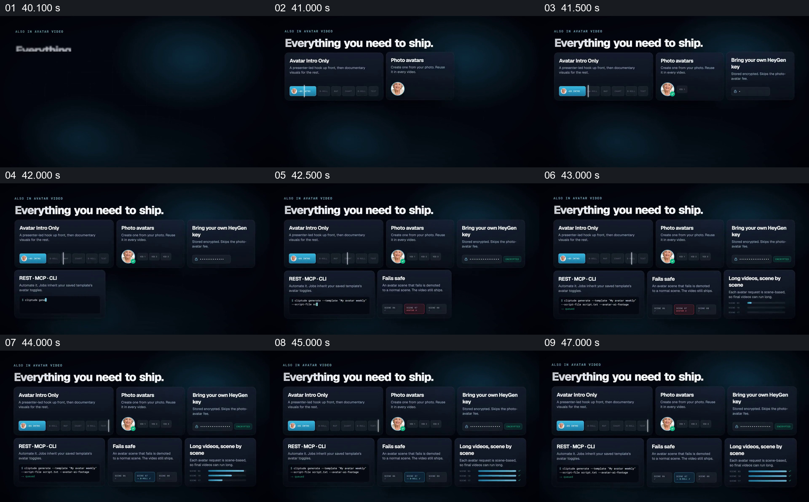

# 逐张积累带小示意的功能卡，最后留下可比较的整体

- 作品：案例 005，数字人物视频产品宣传（库内案例）。
- 原片范围：40.000–48.000 秒；[完整原片](../video.mp4)｜[本卡片段](c05.mp4)。范围为含起点、不含终点；源片末尾音视频流时长略有差异。
- 观察方式与未确认范围：查看全片 64 帧总览和本卡带源时间九宫格；未独立完成原速连续观看或听审，采样间的运动、真实节奏、声音及同步未确认。以下设计价值是依据画面作出的分析，迁移尚未实测。

## 原画面具体怎样设计

约 40 秒，深色蓝光背景中央上方出现“Everything you need to ship.”；其下先出现头像开场和照片人物等功能卡，卡片都有简短标题、正文及小型示意。随后右侧和第二行逐步补齐密钥、命令接口、失败处理以及分场景长视频等卡，最后形成三列两行。

每张卡的内部示意不同：第一张是一串段落块，照片卡有小圆头像与多个输出位置，密钥卡有输入及状态标识，命令卡是深色代码窗口，失败卡有几块场景状态，长视频卡有横向进度条。已出现的卡片在后续源帧中留在网格里，新卡填入空位；小型示意的状态也在不同帧中发生变化。

## 为什么这样设计，好在哪里

大标题先定义这是一个能力集合，分批建立使注意力可以依次落到新卡，而不是首次就面对六组细字。已建立卡片不随新卡消失，因此到最后观众能同时看到能力清单；每项都有属于自己的微型对象，帮助区分“人物开头”“状态处理”和“多个场景”等不同工作。

这些内部界面只是表达功能的可见示意，并不足以验证功能可用性。截图无法确定每张卡的真实停顿与小动画是否同时播放，效果分析依赖其可见的累积关系。

## 可直接使用的创意指令

适用于需要在较短篇幅中交代一组彼此不同但服务于同一目标的能力。为每项准备简洁标题、一句准确说明及能说明该项结果的小型可视示例；先建立统一的容器和标题，再让新项依次补入，保留已出现项目，最终形成能够回看的完整集合。

小示意应表现该项特有的对象或状态，不要让所有卡只换图标；在横竖画幅、数量、颜色及网格密度上按阅读需要调整。若信息需要长时间阅读，应增加停留或拆成合理段落，而不是仅靠缩小字号塞进一屏。
