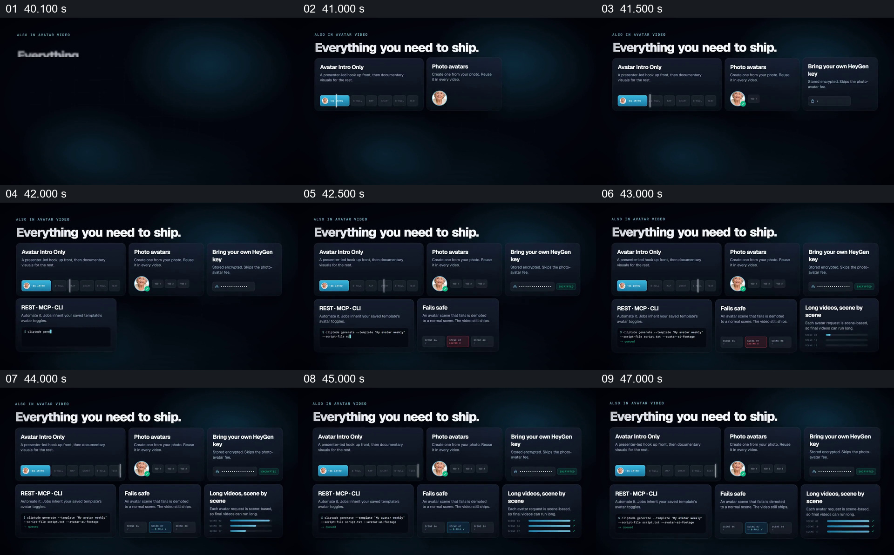

# 把不同功能收成一组带小示意的能力清单

- 作品：案例 005《数字人画面与产品介绍》（索引名称）。
- 原片范围：00:40.000–00:48.000，含起点、不含终点；[完整原片](../video.mp4)｜[本卡完整片段](c05.mp4)。
- 观察方式：按整片 64 宫格和约每秒一个原片帧观察全片，并选取下方九个源帧；未连续原速观看或听审，声音、口型同步及语气保持未知。

## 原画面具体怎样设计

“Everything you need to ship.” 下方逐步出现六张深色卡片，分别标出人物开场、照片人物、自带服务密钥、接口调用、失败处理和分场景长视频等主题。每张卡都有短说明和小型界面、头像、代码或进度示意；最后六张卡同时留在画面。

## 为什么这样设计，好在哪里

统一的卡片边界便于把不同功能当作同一产品的组成，卡内的不同小示意又使它们不完全依赖标题辨认。六卡同时出现适合总览，但原片中小字密集，不足以单独证明各功能实际工作或保证所有文字都能轻松读完。 这是基于画面的作品分析，不代表作者自述或已测量的观众反应。

## 可直接使用的创意指令

当需要概览多项已经确认的能力时，先按观众要解决的问题确定每项的短标题和关键差异，为每项配能体现该差异的小型真实界面或标注示意；逐项建立后保留整体，必要时再单独放大最重要的项目。控制同屏密度并给出可阅读的时间，功能、失败处理和接口条件必须与实际产品一致。
