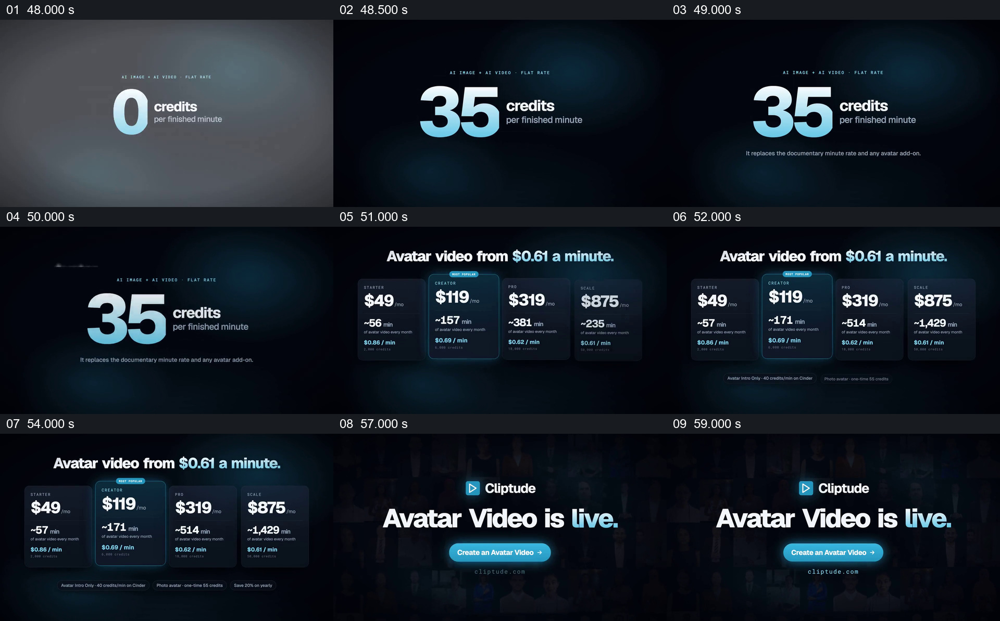

# 从计费单位转到方案比较，再用入口收束

- 作品：案例 005，数字人物视频产品宣传（库内案例）。
- 原片范围：48.000–60.053 秒；[完整原片](../video.mp4)｜[本卡片段](c06.mp4)。范围为含起点、不含终点；源片末尾音视频流时长略有差异。
- 观察方式与未确认范围：查看全片 64 帧总览和本卡带源时间九宫格；未独立完成原速连续观看或听审，采样间的运动、真实节奏、声音及同步未确认。以下设计价值是依据画面作出的分析，迁移尚未实测。

## 原画面具体怎样设计

约 48 秒，深色背景中央先出现巨大的浅蓝数字和右侧较小的“credits per finished minute”；数字最后显示 35，下方有一行说明。观众首先只能读到计费单位，而不是同时面对多种套餐。

约 50 秒，单个数字退出，上方标题显示每分钟起价；下方四张深色竖卡横向排列，分别标出月费、可用分钟及每分钟价格，其中第二张有蓝色描边和“Most popular”标签。源帧显示分钟数经历变化，后面形成完整比较；底部还有较小的附加说明。约 57 秒，套餐让位于深色人物拼贴背景，品牌、Avatar Video 字样和蓝色创建按钮居中出现。

## 为什么这样设计，好在哪里

先给一个单位，再给多个按同一格式排列的方案，可以让观众带着统一口径阅读后面的差别；相同宽度的卡片和相同位置的价格、分钟数让横向比较有参照。第二张的描边把它设为片中优先展示的选项，其他方案仍保留在旁边。

最后把入口从密集比较表中分离出来，让“接下来做什么”成为新中心。数字、价格和最受欢迎标签仅为原片宣传画面，既不能证明当前价格，也不能证明实际用户选择。

## 可直接使用的创意指令

用于解释实际可核实且统计口径一致的计费或方案。先让一个能解释后续表格的基本单位单独出现并读清，再将少量方案以相同字段和位置并列；需要强调一项时使用视觉层级，同时保留其他方案的可读性。比较完成后，把真实可执行的下一步单独呈现。

可改用非价格的指标、横竖布局或其他强调方式，但须保留共同口径、各项可比较以及结果与入口的先后关系。价格、时间、权益和推荐依据应根据新项目实际信息填写；信息较密时为阅读留足时间。
