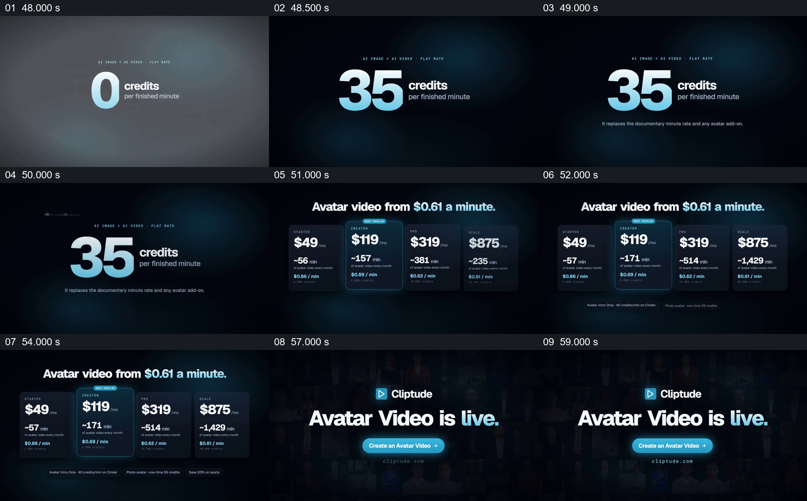

# 从计费单位转到方案比较，再用入口收束

- 作品：案例 005，数字人物视频产品宣传（库内案例）。
- 原片范围：48.000–60.053 秒；[完整原片](../video.mp4)｜[本卡片段](c06.mp4)。范围为含起点、不含终点；源片末尾音视频流时长略有差异。
- 观察方式与未确认范围：查看全片 64 帧总览和本卡带源时间九宫格；未独立完成原速连续观看或听审，采样间的运动、真实节奏、声音及同步未确认。以下设计价值是依据画面作出的分析，迁移尚未实测。

## 原画面具体怎样设计

约 48 秒，深色背景中央先出现巨大的浅蓝数字和右侧较小的“credits per finished minute”；数字最后显示 35，下方有一行说明。观众首先只能读到计费单位，而不是同时面对多种套餐。

约 50 秒，单个数字退出，上方标题显示每分钟起价；下方四张深色竖卡横向排列，分别标出月费、可用分钟及每分钟价格，其中第二张有蓝色描边和“Most popular”标签。源帧显示分钟数经历变化，后面形成完整比较；底部还有较小的附加说明。约 57 秒，套餐让位于深色人物拼贴背景，品牌、Avatar Video 字样和蓝色创建按钮居中出现。

## 为什么这样设计，好在哪里

先给一个单位，再给多个按同一格式排列的方案，可以让观众带着统一口径阅读后面的差别；相同宽度的卡片和相同位置的价格、分钟数让横向比较有参照。第二张的描边把它设为片中优先展示的选项，其他方案仍保留在旁边。

最后把入口从密集比较表中分离出来，让“接下来做什么”成为新中心。数字、价格和最受欢迎标签仅为原片宣传画面，既不能证明当前价格，也不能证明实际用户选择。

## 完整照排指令

以[完整原片](../video.mp4)的 48–60.053 秒为准。画幅 1280×720，源帧率 30/1。以下拍点为抽帧定位，位置按画幅百分比取近似值。

### 用料

- 【邻段读数】【邻段单位】沿用前卡同名项，另备【计费补句】【单价主句】。四档各备【档位名称】【档位价格】【档位用量】【档位附注】，由同一计价资料推导，核对周期、币种、税费与进位。附可打开的当前价格页或带日期的存档。不同档位按照同一单位比较。
- 【品牌标识】【发布主句】【入口按钮】【入口短链】对应同一个明确可达入口。暗背景的【样片缩图】选用可展示的实际产品成品。

### 按源时刻摆放

1. **48.000–约 50.000 秒。** 近黑蓝底与青色光晕。居中组的左边为特大浅青粗【邻段读数】，右边上面用中等白粗【邻段单位】，下边小字补计量对象。再在整组下以灰白小【计费补句】说清口径。读数保持，先看懂单元，再换方案。
2. **约 50.000–52.000 秒。** 读数整组退，让【单价主句】在靠左上区域以粗白一行出现，单价与单位偏浅青。下部四张竖暗卡从左往右建立，同底线、同宽，左端约 x4%，右端约 x97%。每卡上缘排极小【档位名称】，中上以大白【档位价格】，其下小一档【档位用量】与数行【档位附注】。原片第二张带独立亮青短签及较亮蓝框，建议用已有推荐关系填这个位置。
3. **约 52.000–56.000 秒。** 四列都留在同一版上，靠下有一行低反差条款。只有示意性数变动才可分层滚出，落稳后四档同口径同屏。严禁领先档覆盖剩余档位；价格之外的信息保持较小但可读。
4. **约 56.000–60.053 秒。** 比较表整体退。用极暗【样片缩图】若干列模糊铺底，保留深蓝效果。中央先立小标【品牌标识】，再排白粗大【发布主句】，句末可转浅青。下方居中亮青圆角【入口按钮】，白小字紧贴中心，按钮下留更小【入口短链】。样片只作暗背景可用固定缩图。至原片末尾切出。

### 局部采用

只有精确计量口径可用 48–约 50 秒。完整方案表可用约 50–56 秒，四档落稳后切。只有真实发布入口则采用最终约 56–60.053 秒。

### 验证状态

已对照逐秒原片画序并读回，核对大读数与单位并列、四档同屏且只强调第二档、末段按钮与暗样片背景。精确切点、原速听看及换料试摆待核。
