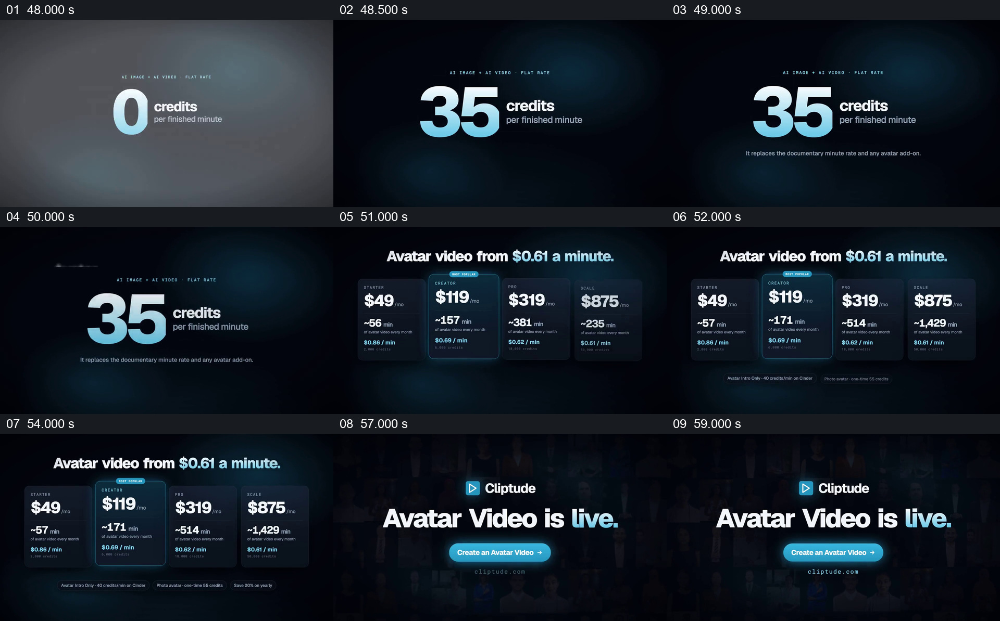

# 先展示计费单位，再并列方案并接到开始入口

- 作品：案例 005《数字人画面与产品介绍》（索引名称）。
- 原片范围：00:48.000–01:00.053，含起点、不含终点；[完整原片](../video.mp4)｜[本卡完整片段](c06.mp4)。
- 观察方式：按整片 64 宫格和约每秒一个原片帧观察全片，并选取下方九个源帧；未连续原速观看或听审，声音、口型同步及语气保持未知。

## 原画面具体怎样设计

画面从大数字过渡到“35 credits per finished minute”，随后标题写人物视频每分钟价格起点，下方并排出现四张月费方案卡，卡内数字逐步更新并显示预计分钟数和每分钟金额；个别卡片以边框突出。最后切到产品标识、“Avatar Video is live.”和创建按钮。

## 为什么这样设计，好在哪里

先呈现计费单位，再比较不同档位，给后续数字一个阅读基准；并排卡片保持同类字段在相近位置，便于按同一维度比较。片中价格、分钟数、上线状态及按钮均为当时的宣传画面，未经独立核实，也不能据此推断当前价格或真实可点击功能。 这是基于画面的作品分析，不代表作者自述或已测量的观众反应。

## 可直接使用的创意指令

当多档产品确有明确计费规则时，先说明共同计费单位及影响费用的条件，再按一致字段并排展示各档价格和可获得内容，突出适合当前观众的差异而不隐藏必要限制。数字变化结束后给足阅读时间，最后接到真实可用的入口。价格、币种、周期和估算口径必须按当前来源核实，示意按钮不等于已上线功能。
