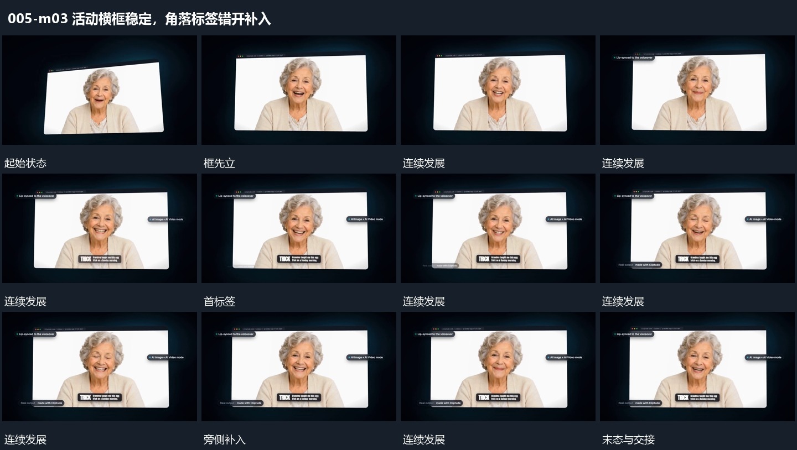

# 活动横框稳定，角落标签错开补入

## 运动指令

先保留横框内持续活动，再在上角、侧边、下角错开补入短标签。已经建立的标签保持，不让整框跟着每次补入抖动或重置。

## 视频切片

[播放本机制的原片切片](m03.mp4)

保留起始准备、连续发展和完成或明确交接；首尾按本段运动范围裁切，不拼接、不变速。尾部只保留理解结果所需的展示。

## 分镜过程

## 组合与调整

可减少标签，必须避开活动重点；下一动作可整体退框，不逐项重复退出。
