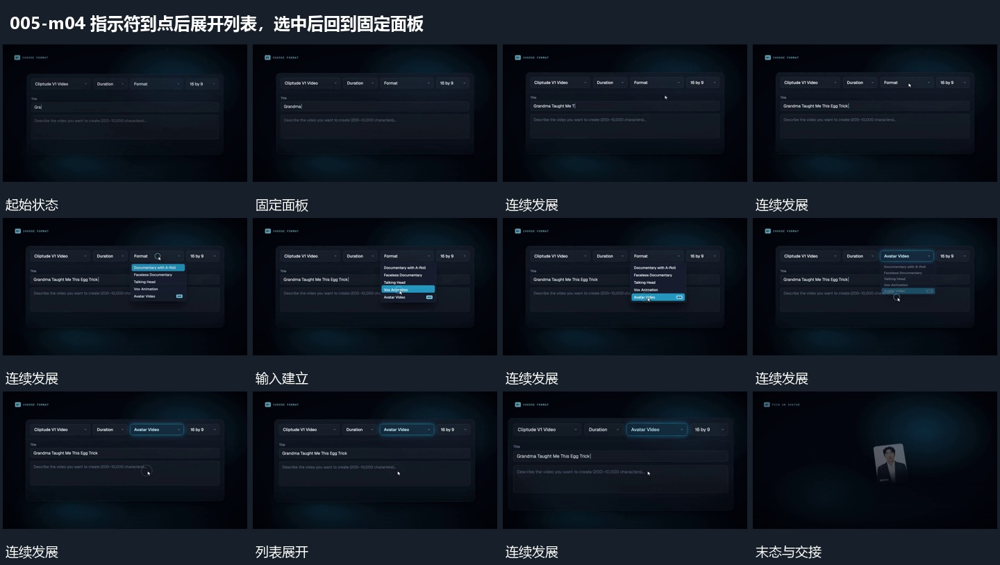

# 指示符到点后展开列表，选中后回到固定面板

## 运动指令

保持外框，先在输入行逐字增加内容，再让指示符移到对应点，展开局部列表。选中后列表收回，原行保留新的短词，旁侧主结构继续留场。

## 视频切片

[播放本机制的原片切片](m04.mp4)

覆盖分镜中“固定面板”至“选中归位”的连续过程，并保留邻近的前后衔接画面；原片中交叠发生的动作一并保留。

## 分镜过程

## 组合与调整

可以复用在开关或条形上，但到达与反馈要有顺序，不能所有状态同时跳变。
