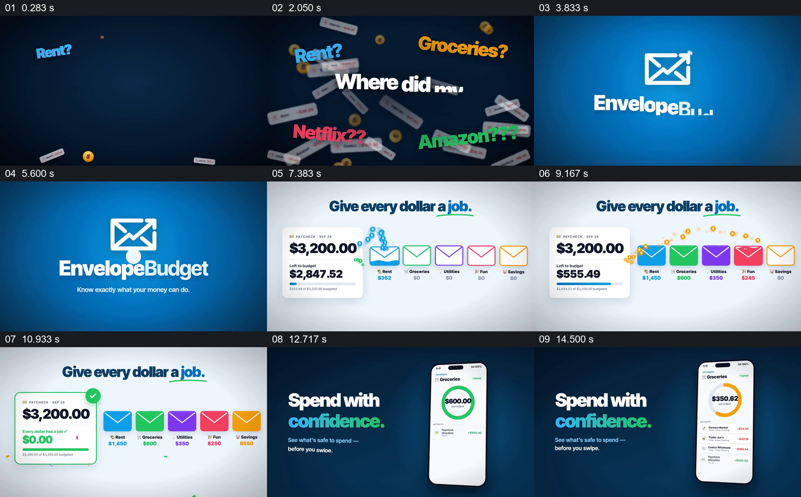

# 把收入分配到不同用途的信封，再查看消费余额

- 作品：案例 046《信封预算分配与消费》（索引名称）。
- 原片范围：00:00.000–00:16.000，含起点、不含终点；[完整原片](../video.mp4)｜[本卡片段](c01.mp4)。
- 观察方式：依据整片 64 宫格和约每秒一次的真实源帧观察，未连续原速观看或听审；声音、语气与完整播放节奏未确认。

## 原画面具体怎样设计

深蓝背景中房租、杂货和购物金额散落，随后出现产品标识。白底显示收入 3,200 美元和五个彩色信封，数字依次分配到房租、杂货等用途，剩余变为零；手机中的杂货环形预算随后随消费变化。

## 为什么这样设计，好在哪里

信封给每一类别独立位置，收入余额与类别金额同时变化，使分配过程可追踪；手机余额延续到消费场景。示例金额及功能未经核实。

以上为依据画面的分析，非作者自述；预期观看效果未经观众测试。

## 可直接使用的创意指令

当解释预算分配时，使用同一笔可核对的示例收入和明确类别，逐项展示分配金额与未分配余额，再用一笔消费更新对应类别；金额应保持算术一致，示例不构成个人财务建议。
