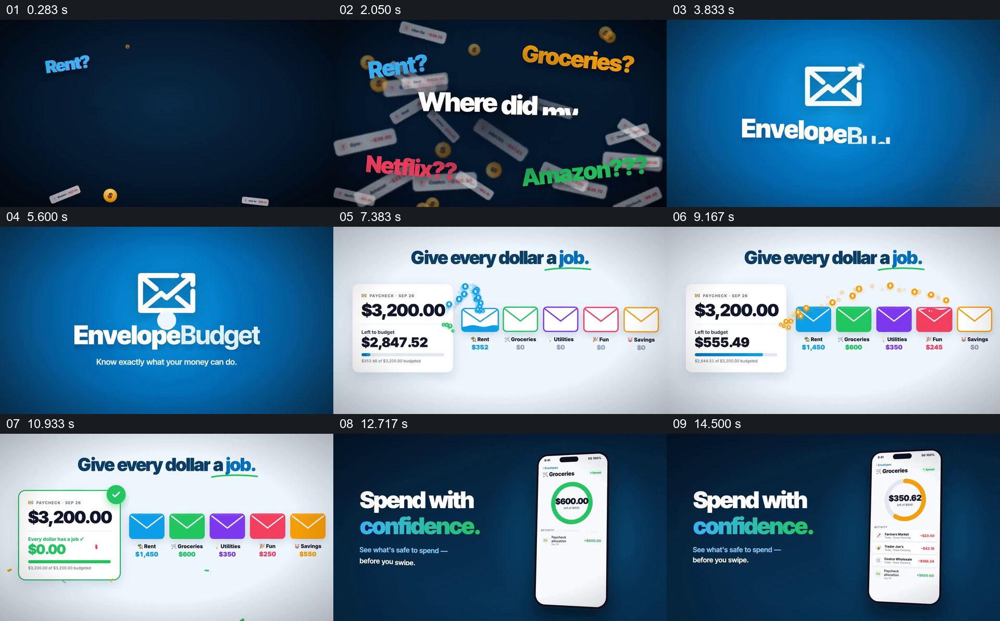

# 把一笔收入分进不同信封，再回到某一类查看余额

- 作品：案例 046《手机、账单与预算图形》（库内索引名）。
- 原片范围：00:00.000–00:16.000，含起点、不含终点；[完整原片](../video.mp4)｜[本卡片段](c01.mp4)，片段起点对应原片 0.000 秒。
- 范围依据：0–16 秒从散落去向到分配完成及单类消费余额，构成一条完整示例；随后进入另一组产品能力与商业条件的展示。
- 观察方式：核看全片 64 帧总览及本卡九宫格；未独立连续原速观看，快速变化和运动节奏待核。未独立听审，声音内容未知。片中事实和演示未独立查证，新题材迁移尚未实测。

## 原画面具体怎样设计

深蓝底上先散落房租、杂货、订阅和购物等词、金额小条及金币，中央提出 “Where did my money go?”；它们退场后出现信封形品牌标记。接着浅色画面左侧是一张收入卡，写 $3,200 和待分配金额；右侧一排蓝、绿、紫、红、橙信封分别代表房租、杂货、公用事业、娱乐和储蓄。

不同颜色的小点从收入卡附近到对应信封的抽样状态依次出现，左侧待分配金额下降，各信封下金额增加，最终五项显示 $1,450、$600、$350、$250、$550，左侧为 $0 并出现完成标记。随后画面转为手机中的杂货预算：环形余额开始显示 $600，下面加入多笔消费，余额降到约 $347.98；左侧文案写 “Spend with confidence.”。演示数值与功能未经外部核验。

## 为什么这样设计，好在哪里

开头把多个去向分散摆出，形成“钱去了哪里”的具体问题；中间同一收入卡和五个固定位置的信封，让资金去向与剩余量同时可见。收入归零是分配动作的结果，接着放大其中杂货信封到手机页面，观众又能看到类别在消费后的状态。颜色让类别在两种表现尺度中较易追踪。

没有待分配额随各类别变化的参照，信封只是装饰；没有后续单类明细，则难以理解分配完如何使用。此处根据抽帧解释其组织，并不证明实际资金转移或应用运行效果。

## 完整照排指令

以[完整原片](../video.mp4)的 0–16 秒为准。画幅 1280×720，源帧率 60/1。以下拍点为抽帧定位，位置按画幅百分比取近似值。

### 用料

【收入总额】【未分配额】【用途组】【分配金额组】【分类消费页】【单项余额】【交易提示】取同一账期、币种与分配案例。账目须可回查，示意数据注明演示。备【开场疑问】【开场账签组】【品牌字】【信封标题】【消费标题】【邻段功能组】。

### 按源时刻摆放

1. **0–约 5.500 秒。** 深蓝黑底，白色斜【开场账签组】和小暖黄圆币从多侧入画，杂排数个不同色重用途词。中部白粗【开场疑问】后加青色重点行。随后以亮青蓝面接管，居中先是白信封线标，再排粗白【品牌字】，小字留底。
2. **约 5.500–10.500 秒。** 切浅灰蓝底，顶部白场用深蓝粗【信封标题】。左侧大白卡上下排【收入总额】【未分配额】，黑粗数与小灰行名留间距。右侧约五只等宽信封沿水平基线从蓝、绿、紫、红到橙排列。先浅轮廓，依次按【分配金额组】充实色，下方恢复对应【用途组】小字与数值。沿每次分配同步扣减左卡，最后归零并转绿，短散彩屑。早先信封始终留在同一位置，禁止用循环表现重复扣款。
3. **约 10.500–14.000 秒。** 硬切深蓝。左侧大号【消费标题】白、青两级，右侧细黑竖手机内为白底【分类消费页】。手机上部用彩圆环包住【单项余额】，下方小交易行，近尾部加浅绿【交易提示】并短压机缘。具体分类应来自前面已填信封；同一手机视图可用实录或静态分层，余额变化只跟实际交易。
4. **约 14–16 秒。** 原整版撤去，橙、紫、红等全屏色面逐个接力，左中简图及右侧白粗【邻段功能组】，最后露出深蓝上的白色桌面。按 16 秒切出。纯预算场可于首个整幅橙底前退出。

### 局部采用

有配齐的分配记录可独立用约 5.500–10.500 秒。仅展示单类交易可用约 10.500–14 秒，须已经交代其归属。

### 验证状态

已对照逐秒原片画序并读回，核对由散签到信封、剩余归零及圆环余额。分配精确帧、原值和换料试摆待核。
