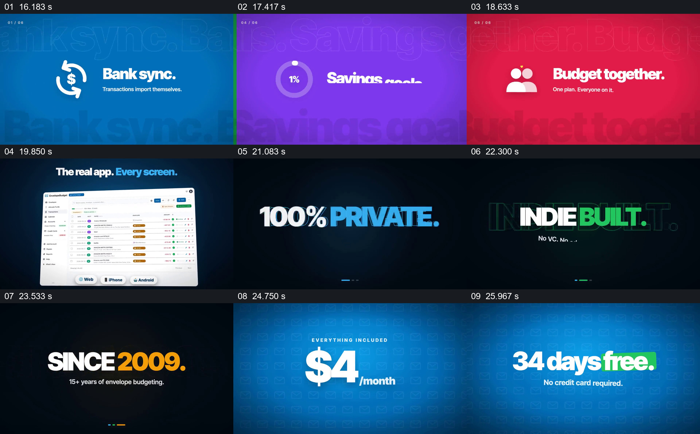

# 以简短功能提示接到真实界面与价格

- 作品：案例 046《信封预算分配与消费》（索引名称）。
- 原片范围：00:16.000–00:27.000，含起点、不含终点；[完整原片](../video.mp4)｜[本卡片段](c02.mp4)。
- 观察方式：依据整片 64 宫格和约每秒一次的真实源帧观察，未连续原速观看或听审；声音、语气与完整播放节奏未确认。

## 原画面具体怎样设计

蓝绿画面依次显示“Bank sync.”、“Reconciled.”和“Reports that pop.”，随后出现一个带多行数据的应用页面；末尾数字展示每月价格和免费试用天数。

## 为什么这样设计，好在哪里

短句先给观众阅读重点，随后页面提供功能所在的整体环境；价格单独展示便于寻找。片中价格和功能未核实。

以上为依据画面的分析，非作者自述；预期观看效果未经观众测试。

## 可直接使用的创意指令

介绍工具时，以实际支持的能力分别给出清楚名称和对应页面；价格、周期及试用条件以当前官方信息为准，示意画面不可代替产品验证。
