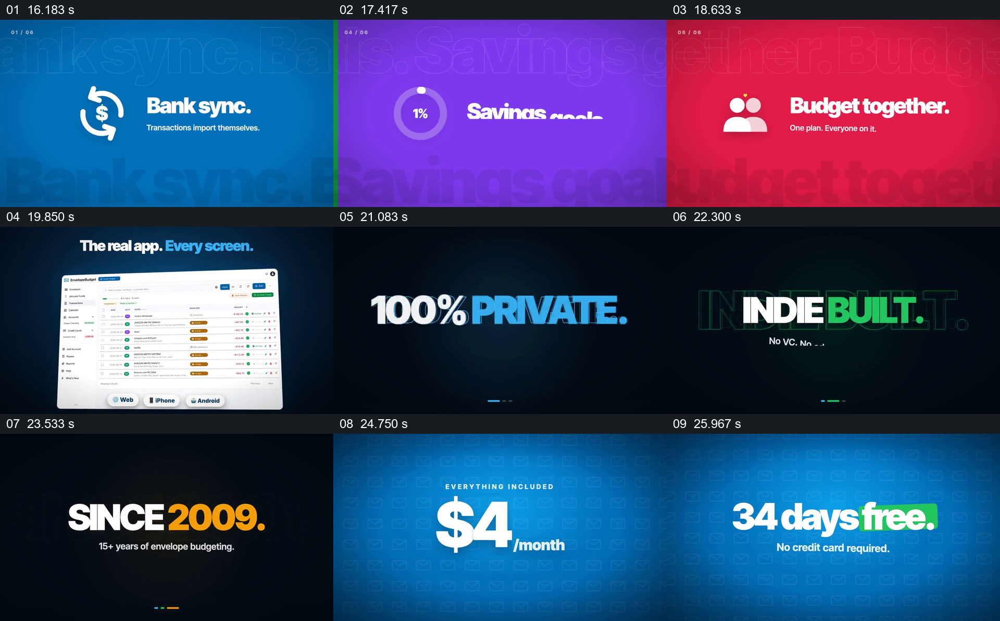

# 用统一的功能短卡串到产品界面、主张和价格

- 作品：案例 046《手机、账单与预算图形》（库内索引名）。
- 原片范围：00:16.000–00:27.000，含起点、不含终点；[完整原片](../video.mp4)｜[本卡片段](c02.mp4)，片段起点对应原片 16.000 秒。
- 范围依据：16–27 秒从功能短卡到应用界面、产品主张和价格试用，形成一组广告信息收束；27 秒后主要为品牌入口。
- 观察方式：核看全片 64 帧总览及本卡九宫格；未独立连续原速观看，快速变化和运动节奏待核。未独立听审，声音内容未知。片中事实和演示未独立查证，新题材迁移尚未实测。

## 原画面具体怎样设计

全屏依次出现多张不同底色的功能页，每张均有一个白色简化图标、较大的功能短语和一行小解释；背景还有放大的低对比轮廓文字。片中依序涉及银行同步、订单明细、对账、储蓄目标、报告及共同预算，左上角的编号从 01/06 延续到 06/06。

功能卡之后切到深蓝背景，一幅略倾斜的桌面应用页面占据中央，标题写 “The real app. Every screen.”，底部有 Web、iPhone、Android 标签。接着几个大字画面分别展示隐私、独立开发、开始年份等主张；最后切到亮蓝底，先突出每月 $4，再突出 34 天免费试用并附无须信用卡的说明，然后进入品牌入口。所有能力、隐私主张、价格和试用条件都只是片中宣传，未独立核实。

## 为什么这样设计，好在哪里

短卡让每项功能占据同一阅读结构：图标帮助识别，短句承担主要信息，小字补充，连续编号提示总共还有几项；改变底色则帮助区分不同项。随后真实外观的界面提供一个整体工作环境，最后把价格和试用从功能列表中独立出来，使观众知道下一步的条件。它的价值来自一系列不同信息按相同层级接力，而不是某一张彩色背景本身。具体功能和宣传不能因出现在精致界面中就视为已证实，观看效果也未测试。

## 完整照排指令

以[完整原片](../video.mp4)的 16–27 秒为准。画幅 1280×720，源帧率 60/1。以下拍点为抽帧定位，位置按画幅百分比取近似值。

### 用料

【功能短卡组】每项配真实功能名、极短说明和图标。准备【桌面总览】【总览题句】【主张组】【价格金额】【价格单位】【试用天数】【试用条件】【品牌字】【入口按钮】【入口地址】。价格、试用、隐私及营业年份逐项提供可打开的正式出处和适用日期。

### 按源时刻摆放

1. **16.000–约 19.000 秒。** 橙、紫、红三种满幅色面依次接管。各版左近中轴放白色图标，右侧一行粗白【功能短卡组】标题及极小白说明，保持共同基线。随后硬切深蓝，顶部白青两色【总览题句】落定，下置浅白【桌面总览】，短推至可认列名和状态。
2. **约 19.000–22.300 秒。** 近黑底，中心位置逐屏换粗白【主张组】，每屏重点词分别以青、绿、橙强调。副行小而低亮，且不与其他主张同屏。用短停留及硬切定节奏。
3. **约 22.300–24.300 秒。** 深蓝光晕回归，中轴先放粗白大【价格金额】及较小【价格单位】，真实终值停稳，再把焦点交给白绿【试用天数】与小【试用条件】。滚动读数只作动画。真实方案价格与试用范围用同口径。
4. **约 24.300–27.000 秒。** 中央白信封线标及白粗【品牌字】，下面白胶囊【入口按钮】，底下更小【入口地址】。彩屑短过后保留稳定品牌和可读入口到切出。总览允许静态，彩屑可持续轻漂，无需循环其他一次性进场动作。

### 局部采用

只需功能展示可用 16–约 19 秒。只具备有据的价格和入口可独立取约 22.300–27 秒。

### 验证状态

已对照逐秒画序并读回，核对三色短卡、近黑三句、计费转试用与蓝底入口。精确切帧、细字与换料待核。
