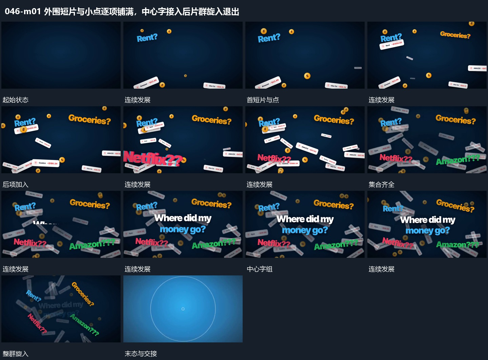

# 外围短片与小点逐项铺满，中心字接入后片群旋入退出

## 运动指令

从画面外围逐项接入短片与小点，已有项保持分散位置。集合齐全后建立中央字组，随后让片群向中心旋入并退去，由新的中央小形接手。

## 视频切片

[播放本机制的原片切片](m01.mp4)

保留起始准备、连续发展和完成或明确交接；首尾按本段运动范围裁切，不拼接、不变速。尾部只保留理解结果所需的展示。

## 分镜过程

## 组合与调整

外围旋入应有共同中心，文字可以随之退弱，避免集合四散离开而失去接力。
