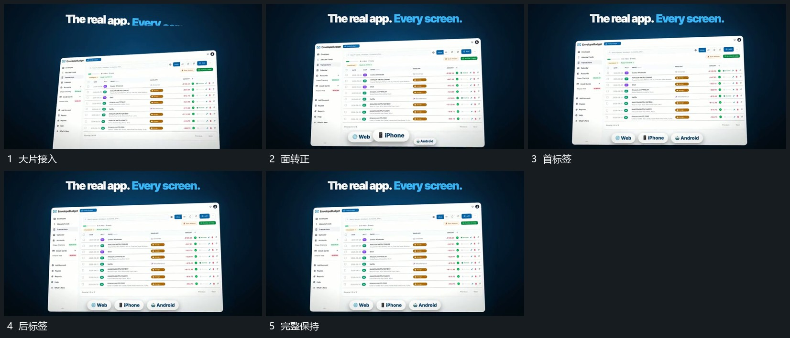

# 大片带倾角进入转正，底部小标签错峰补齐

## 运动指令

让大片带倾角进入，逐步转正到可读姿态。主面稳定后在底部错峰接入小标签，已有标签保持，最终面与附属组共同稳定。

## 视频切片

[播放本机制的原片切片](m05.mp4)

覆盖分镜中“大片接入”至“完整保持”的连续过程，并保留邻近的前后衔接画面；原片中交叠发生的动作一并保留。

## 分镜过程

## 组合与调整

附属组不要抢主面建立空间，标签数由新片需要决定。
