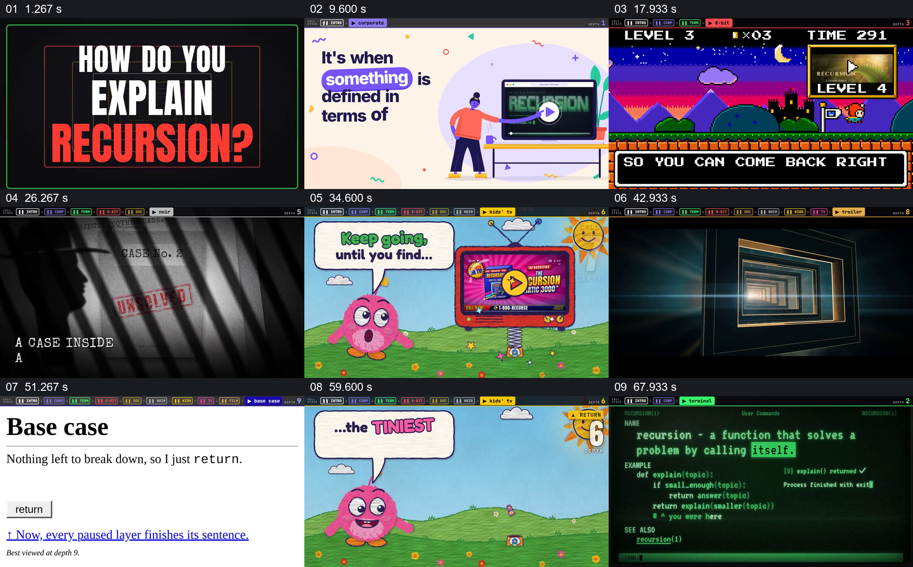

# 让解释视频不断进入自身，直到终止条件后逐层返回

- 作品：案例 066《多层媒介中的递归解释》（索引名称）。
- 原片范围：00:00.000–01:14.986，含起点、不含终点；[完整原片](../video.mp4)｜[本卡片段](../video.mp4)。
- 观察方式：依据整片 64 宫格和约每秒一次的真实源帧观察，未连续原速观看或听审；声音、语气与完整播放节奏未确认。

## 原画面具体怎样设计

开头提问如何解释递归，屏幕播放另一段解释视频，画面继续进入终端、像素游戏、自然纪录片、侦探片、儿童套娃节目、购物节目和电影预告；顶部深度标识不断变化。白色页面显示“Base case”和返回提示后，各种媒介样式按相反顺序重新出现，最后回到最初的视频窗口与提问。

## 为什么这样设计，好在哪里

媒介不断套入使递归关系直接成为观看结构；基础情形后的逆序回访让先前暂停的层得到回应，不只靠定义文字解释。具体代码、返回机制和连续声音尚未核验。

以上为依据画面的分析，非作者自述；预期观看效果未经观众测试。

## 可直接使用的创意指令

当解释嵌套调用时，先确定每层进入下一层的明确接口与可辨身份，让调用逐渐深入；设置有依据的终止条件，再按实际依赖顺序返回并完成先前未完成的动作。风格可变化，但进入、停止和返回关系需在连续观看中清楚成立。
