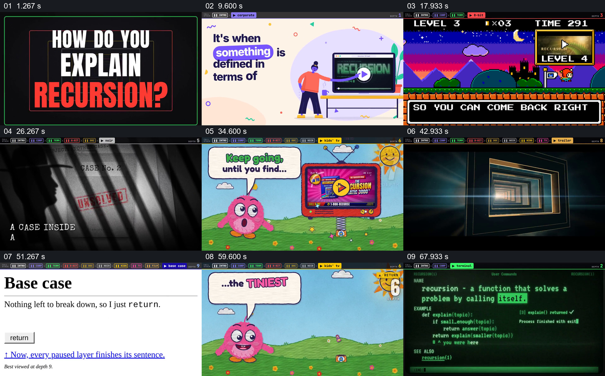

# 让解释本身不断进入下一层，再沿原路返回

- 作品：案例 066（库内案例）。
- 原片范围：0.000–74.986 秒；[原片](../video.mp4)｜[片段](../video.mp4)。含起点、不含终点。
- 观察方式：查看全片 64 格与本卡九宫格；未独立原速连续观看或听审，动作衔接、数据及迁移未核实。

## 原画面具体怎样设计

开头大字问“HOW DO YOU EXPLAIN RECURSION?”，答案是播放一段解释视频；画内视频进入明亮的企业动画，其中屏幕又指向绿色终端。终端里的定义和示例接到像素游戏，游戏中的小窗口引向自然纪录片，再进入黑白侦探、儿童套娃节目、电视购物和电影预告。每一层都拥有不同的字体、画幅内装饰和叙述语境；上方小标签记录已进入的层级及深度。

预告片的层层画框把观众带到一张几乎空白的“Base case”页面，文字说没有可继续拆分的内容，提供 return。之后各已建立的媒介风格按相反方向重现：购物节目、儿童节目、侦探、纪录片、游戏、终端和最初的解释画面；例如儿童角色补完之前未说完的“the TINIEST”，游戏显示通关，终端显示返回。最终最初的问题画面再次进入窗口，形成首尾对应。完整播放才能确认所有返回与语句是否精确接续。

## 为什么这样设计，好在哪里

每进入一层就暂时留下上一层的问题和独特风格，观众既能看见“进入自身”，也能凭顶部层级标识知道现在有多深。基础情形以极简页面和 return 将深入过程明确停住；逆序回访不是重复蒙太奇，而是让先前中断的句子或任务得到完成，因而表现调用和返回的依赖。若省略停止条件或直接跳回开头，递归就只剩无限套娃的外观。

## 完整照排指令

以[完整原片](../video.mp4)的 0–74.986 秒为准。画幅 1280×720，源帧率 30/1。以下拍点为抽帧定位，位置按画幅百分比取近似值。

### 源时刻照排

- 0–5 秒，暗底套线框里用居中极粗窄体【开场问题】，重点分黄、红，短切红底黑字【简答】，回暗底给【播放引子】，中央嵌【解释片窗口】。
- 5–10 秒，窗口放大接管全幅。浅底企业课件左排【解释前半句】，右侧人物指向屏幕，屏内预显下一层终端画面。顶缘留细色带【层级记录】，每层继续累积标记。
- 10–15 秒，绿字黑底【终端画面】占满，以等宽字建立【定义与代码】，其中关键字用亮色反白。右侧预显游戏，画中出现入层编号。
- 15–20 秒，切像素【游戏画面】，上沿像素 HUD，底沿黑色白字【游戏半句】，右上小框嵌下一层纪录片；保留角色、关卡与文本状态。
- 20–25 秒，纪录片以暖绿蕨叶特写和小号斜体【纪录片半句】补景深，逐步找到下一层窗口；25–30 秒进黑白高反差【侦探画面】，底部等宽【侦探半句】，画内屏幕把视线引向儿童场景。
- 30–35 秒，【儿童节目画面】以彩色草地、拟人角色和描边气泡【儿童半句】建立套娃递进，电视出现下一层；35–40 秒换【购物节目画面】，全幅放射背景、大描边标题、下缘频道条，保留节目电视和【购物半句】。
- 40–46 秒，【预告片画面】用暗金字、矩形套框向深处推进；约 46–53 秒落到白底【终止页面】，上方黑色衬线【终止标题】、正文【终止说明】，其下依次出现【返回按钮】和【逐层返回提示】。
- 约 53–74.986 秒，逆序恢复预告片、购物、儿童、侦探、纪录片、游戏、终端、解释片，顶部【层级记录】跟随退栈。前景【各层续句】接回原位置；儿童补完最小套娃，游戏在原关卡通关，终端出现退出提示，解释片补完定义。约 71 秒以后回暗底套框，以【收尾提示】和窗口内【开场问题】收尾。

### 用料与取用

【解释片窗口】【终端画面】【游戏画面】【侦探画面】【儿童节目画面】【购物节目画面】【预告片画面】与纪录片原景须各有入层前画面、能显示下层的可分层窗口、返回后续演。每一嵌窗从该层后半拍开始展示下层开头，到下层全屏接管，返回时同一窗和外层状态连续；等待期间允许叙事暂停，恢复后须有真实动作或动画，禁循环、静图运镜充当续演。提供同一张进入／返回顺序表给【层级记录】及短片深度数字，底层【终止页面】必须有明确无下层状态。【开场问题】【简答】【播放引子】【解释前半句】【定义与代码】【游戏半句】【纪录片半句】【侦探半句】【儿童半句】【购物半句】【终止标题】【终止说明】【返回按钮】【逐层返回提示】【各层续句】【收尾提示】需成套，前半句与续句在同一媒介层能接成完整意思，代码例有终止条件。供原创游戏画面和角色、合法媒介素材；若引用术语或程序示例，提交对应文档位置。单拍只有一层材料时，可取相应表演段，如 30–35 秒儿童比喻；若只做约 46–53 秒终止页，可作为独立定义，删掉没有前层支撑的层号和回栈说明。

### 验证状态

已对照原片分段逐秒抽帧与卡稿，回查前进顺序、终止页、逆序返回和首尾嵌窗。精确切点、台词接续原速听看及换料试摆待核。
