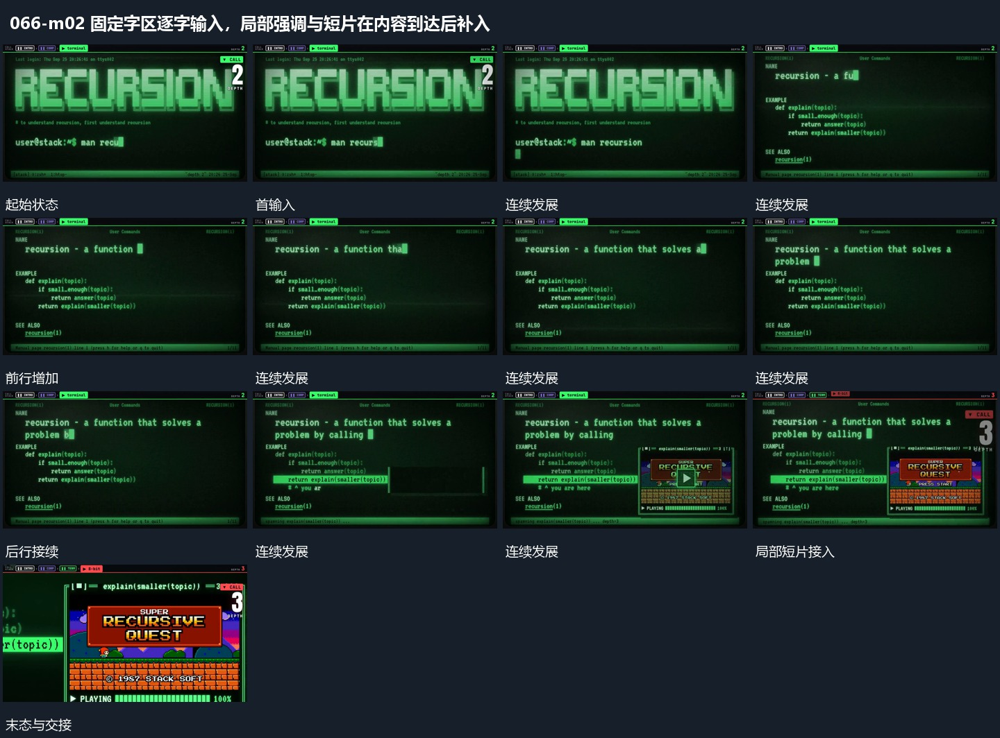

# 固定字区逐字输入，局部强调与短片在内容到达后补入

## 运动指令

在固定字区沿行逐字输入，当前行到末尾后再接下一行，旧行完整保持。输入到重点时追加局部强调，短片在其后接入；活动底层更新时字区位置可保留。

## 视频切片

[播放本机制的原片切片](m02.mp4)

覆盖分镜中“首输入”至“下一字区继续”的连续过程，并保留邻近的前后衔接画面；原片中交叠发生的动作一并保留。

## 分镜过程

## 组合与调整

原片代码是可见字面，不作为当前命令执行。
