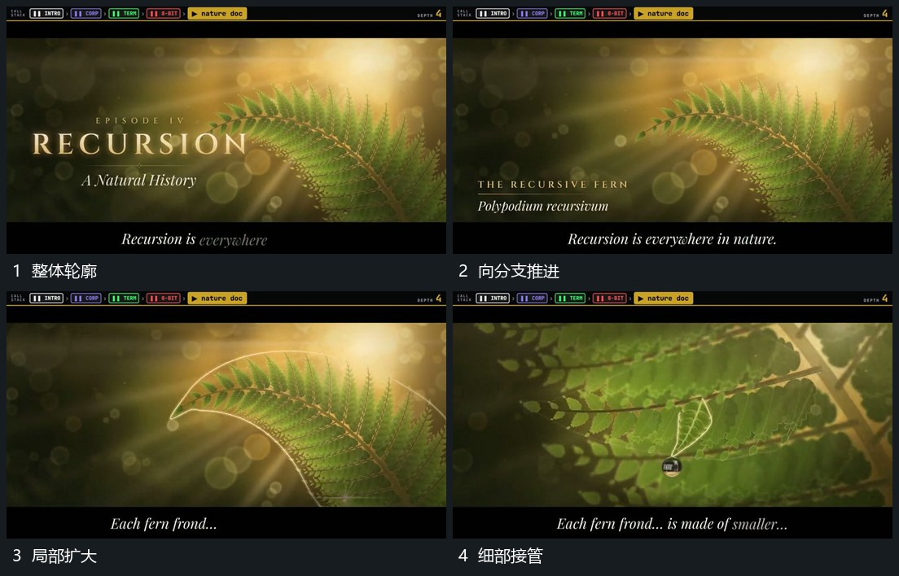

# 沿分支推近局部，重复小形逐渐接管视野

## 运动指令

在包含重复小形的大轮廓中选择一条分支，沿分支向局部推近。近处重复形扩大，外围轮廓移向边缘，末尾细部接管主要视野，旁字和短标签接续。

## 视频切片

[播放本机制的原片切片](m03.mp4)

覆盖分镜中“整体轮廓”至“细部接管”的连续过程，并保留邻近的前后衔接画面；原片中交叠发生的动作一并保留。

## 分镜过程

## 组合与调整

不分析原植物或主体，保留从整体分支到重复局部的运镜关系。
