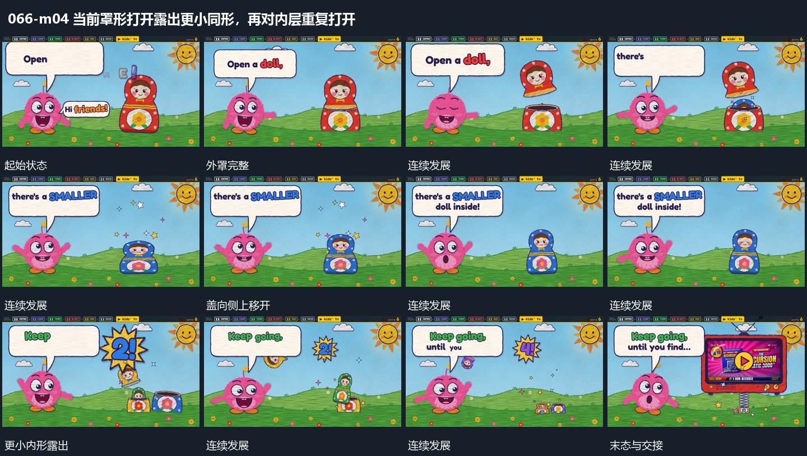

# 当前罩形打开露出更小同形，再对内层重复打开

## 运动指令

把当前罩形上部提起并向侧边移开，露出内部更小同形，外罩底部保留。对显露的内形再次执行打开动作，层层缩小，前层气泡可在每次揭示后接续更新。

## 视频切片

[播放本机制的原片切片](m04.mp4)

保留起始准备、连续发展和完成或明确交接；首尾按本段运动范围裁切，不拼接、不变速。尾部只保留理解结果所需的展示。

## 分镜过程

## 组合与调整

重复次数按表达需要决定，内形位置要来自原罩内部，避免凭空另起一组。
